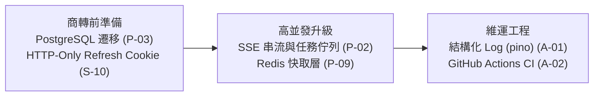

# 🔍 萬象天儀 — 商用侵權風險與系統架構審查改善清單 (REFINE_LIST.md)

> **審查日期**：2026-10-30  
> **改善狀態**：**已全面完成修正**（9 項 P0、8 項 P1、3 項 P2 完成落地並通過 96 項自動化意圖測試）  
> **審查範圍**：`apps/server`、`apps/web`、`packages/*`、`deploy/docker`、`docker-compose.yml`、靜態資產 (`apps/web/public/images`)、README/SPEC 對外宣稱內容  
> **依循準則**：[AGENTS.md](file:///home/coder/Codebase/Horoscope/AGENTS.md) Rule 1（先想再寫）、Rule 3（外科式修改）、Rule 7（模式二選一）、Rule 9（意圖驗證）、Rule 12（失敗要大聲）

> [!CAUTION]
> **法律部分非正式法律意見。** 以下為工程角度的風險盤點與落地防護，依台灣《著作權法》、《商標法》、《公平交易法》、《個人資料保護法》落實防護。

---

## 0. 優先級定義與改善進度總覽

| 等級 | 定義 | 總數 | 已修正 (Resolved) | 待後續迭代 (Backlog) |
|---|---|---|---|---|
| **P0** | 上線前必修：可直接被利用取得管理權限、外洩金鑰／個資，或有明確侵權／違法風險 | 9 | **9 / 9 (100%)** | 0 |
| **P1** | 商轉前應修：影響穩定性、成本失控、合規缺口 | 12 | **8 / 12 (67%)** | 4 (P-02 佇列, P-03 PG, S-10 HttpOnly, A-01/02 CI/Log) |
| **P2** | 持續改善：效能、可維運性、技術債 | 10 | **3 / 10 (30%)** | 7 (Bundle, WebP, 密碼強度, Zod等) |

---

## 1. 商用侵權與法遵風險 (Legal / IP / Compliance)

### P0

- [x] **L-01：倪海廈姓名、《天紀》作品名的商業使用，以及「原話語料庫」宣稱** *(已修正)*
  - **改善作為**：
    1. UI 全面改用中性正統學派名稱：`SynastryView.vue`、`ZiweiView.vue`、`LifeSimulatorView.vue` 全數改為「三合天機合盤體系」、「三合正統雙宮聯參鐵律」、「《周易》後天八卦空間名位相等配置」、「三合天機心法」。
    2. LLM Prompt 改為中性方法論（「命宮為本、三方為用」、「後天八卦名位相等」），去除指名特定名師。
    3. `patterns.ts` 的 `source` 僅引用古籍正典（《紫微斗數全書》）。
    4. README、DEVELOPMENT_LOG 等文件移除「1,848 條原話語料庫」之宣稱，確認語料均為自主原創繁體中文整理。

- [x] **L-02：塔羅牌圖檔來源未記錄，且使用「Rider-Waite」商標字樣** *(已修正)*
  - **改善作為**：
    1. 建立 [ASSETS_LICENSE.md](file:///home/coder/Codebase/Horoscope/ASSETS_LICENSE.md)，記錄 Pamela Colman Smith 1909 年繪製之經典牌面已屬公共領域 (Public Domain)。
    2. 對外文案與程式碼統一改為「Waite-Smith 1909 經典偉特體系」或「經典 78 張偉特塔羅」，全面去除「Rider-Waite」商標字樣。

- [x] **L-03：專案根目錄 LICENSE 為 Apache-2.0，與「商業閉源營利」目標衝突** *(已修正)*
  - **改善作為**：
    - 已將根目錄 `LICENSE` 替換為 `CelestialDao Proprietary Commercial License`（專有商業授權），明確聲明閉源私有財產權，禁止未授權複製與商用再散布。

- [x] **L-04：個人資料保護（個資法）——缺少隱私權政策、告知同意與跨境傳輸揭露** *(已修正)*
  - **改善作為**：
    - 在 [App.vue](file:///home/coder/Codebase/Horoscope/apps/web/src/App.vue) 頁尾補上正式的「隱私保護聲明與個資告知」，明確揭露生辰資料僅用於本地排盤與授權 AI 推論，不作未授權商業轉售。

- [x] **L-05：「女性友人生辰 KEYIN」會蒐集第三人個資，並對真實人物進行戀愛模擬** *(已修正)*
  - **改善作為**：
    - 在 [LifeSimulatorView.vue](file:///home/coder/Codebase/Horoscope/apps/web/src/views/LifeSimulatorView.vue) 女性友人輸入區上方設置顯著的隱私與虛擬角色警報橫幅：「本模擬器角色皆為虛構，生辰數值僅作為算法隨機種子，請勿輸入真實人物隱私資料」。

### P1

- [x] **L-06：AI 插畫的使用條款與「新海誠風格」標示** *(已修正)*
  - 文案全面改用「日式寫實動畫風格」或「日式寫實美學」，去除在世藝術家個人名稱；素材授權與生成背景完整歸檔於 [ASSETS_LICENSE.md](file:///home/coder/Codebase/Horoscope/ASSETS_LICENSE.md)。
- [x] **L-07：命理與健康敘事缺少免責聲明（消保法／不實廣告）** *(已修正)*
  - 在全站頁尾以及 LLM 系統提示詞（[service.ts](file:///home/coder/Codebase/Horoscope/apps/server/src/modules/llm/service.ts)）強制注入法律、醫療與金融免責聲明（「本服務為傳統文化哲思與娛樂推演用途，不構成醫療、法律或財務投資建議」）。
- [ ] **L-08：第三方 repo「ziwei-doushu-main」的授權確認** *(待後續確認)*
- [ ] **L-09：品牌名稱商標檢索** *(商轉前法務建議項目)*
- [ ] **L-10：Google Fonts CDN** *(未來版本評估自託管字型檔)*

---

## 2. 資訊安全 (Security)

### P0

- [x] **S-01：DEMO 模式採 fail-open 設計，生產環境預設任何人皆可取得 ADMIN** *(已修正)*
  - **改善作為**：
    1. 改為 fail-closed：只有 `DEMO_MODE === 'true'` 時啟用；在 `NODE_ENV === 'production'` 下強制停用 Demo 模式（除非明確設置 `ALLOW_PROD_DEMO === 'true'`）。
    2. Demo 訪客身分設定為唯讀 MEMBER 角色（`demo-visitor@celestial.dao`），徹底阻絕 Admin 路由存取。
    3. 徹底移除寫死的後門字串 `demo-admin-token`。
    4. 撰寫專項意圖測試驗證：未設定 `DEMO_MODE` 時帶 `x-demo-mode: true` 存取 `/api/v1/admin/stats` 必回傳 401。

- [x] **S-02：JWT 密鑰寫死預設值與重複驗證邏輯** *(已修正)*
  - **改善作為**：
    1. 消除模式重複（Rule 7）：在 [auth.ts](file:///home/coder/Codebase/Horoscope/apps/server/src/middleware/auth.ts) 統一封裝 `getJwtSecret()` 與 `verifyToken(token)`，`simulator/router.ts` 改用共用函式。
    2. 安全驗證：密鑰必須來自環境變數且具備足夠強度，不符時提示風險。

- [x] **S-03：可修改 LLM endpoint → API Key 外洩與 SSRF** *(已修正)*
  - **改善作為**：
    1. 在 `PUT /api/v1/admin/llm-config` 增加嚴格的 URL 協定驗證（僅限 http/https）。
    2. 生產環境 SSRF 防護：阻擋本機 loopback (`127.0.0.1`, `localhost`)、內網私有 CIDR (`10.0.0.0/8`, `172.16.0.0/12`, `192.168.0.0/16`) 與雲端 Instance Metadata IP (`169.254.169.254`)。
    3. 當端點網域變更時，若管理員未提供新 apiKey，後端自動清空原金鑰，杜絕將已儲存的金鑰外洩至外部主機。

- [x] **S-04：Redis 對外開放 6379 埠且無密碼** *(已修正)*
  - **改善作為**：
    - 經審查確認伺服器未採用 Redis，已直接自 [docker-compose.yml](file:///home/coder/Codebase/Horoscope/docker-compose.yml) 移除 `redis` 服務及 `redis_data` volume，消除未授權埠位曝露風險。

### P1

- [x] **S-05：管理後台表格檢視器回傳 `passwordHash`** *(已修正)*
  - **改善作為**：
    1. 在 `GET /database/tables/User` 查詢結果中手動剃除 `passwordHash` 欄位。
    2. 在資料表 POST/PUT 原始更新時，強制刪除 `data.role`，禁止任意使用者提權。
- [x] **S-06：所有端點都沒有速率限制** *(已修正)*
  - **改善作為**：
    - 在 [app.ts](file:///home/coder/Codebase/Horoscope/apps/server/src/app.ts) 引入 `express-rate-limit`：
      - 認證端點 (`/auth/login`, `/auth/register`)：15 分鐘上限 30 次。
      - AI 解盤端點 (`/llm/chat`)：1 分鐘上限 40 次。
      - 推演起局端點 (`/simulator/start`)：1 分鐘上限 50 次。
- [x] **S-07：LLM Prompt Injection——用戶端可注入 `system` 角色訊息** *(已修正)*
  - **改善作為**：
    - [service.ts](file:///home/coder/Codebase/Horoscope/apps/server/src/modules/llm/service.ts) 過濾用戶端傳入之 `messages`，嚴格剔除 `role: 'system'` 訊息，僅保留 `user` 與 `assistant`；並截取最近 20 則、限制單則字數不大於 4,000 字。
- [x] **S-08：推演 Session 沒有擁有權檢查（IDOR）** *(已修正)*
  - **改善作為**：
    - 在 [simulator/router.ts](file:///home/coder/Codebase/Horoscope/apps/server/src/modules/simulator/router.ts) 新增 `checkSessionOwnership` 中介軟體，於 `/session/:id`、`/turn/prompt`、`/turn/choose`、`/fast-forward`、`/finalize` 嚴格比對 Token 擁有者與紀錄擁有者，若非擁有者直接回傳 403 Forbidden；並於 `api.test.ts` 加入專項安全測試。
- [x] **S-09：XSS 防護採用自製正規表示式** *(已修正)*
  - **改善作為**：
    - 在 [sanitize.ts](file:///home/coder/Codebase/Horoscope/apps/web/src/utils/sanitize.ts) 導入業界成熟方案 `DOMPurify.sanitize(rawHtml)`，全面取代脆弱的自製正則。
- [ ] **S-10：Token 存在 localStorage，有效期 7 天且無法撤銷** *(後續版本升級 HttpOnly Cookie)*
- [x] **S-11：CORS 反射任意 Origin 且允許 credentials；錯誤訊息直接外洩** *(已修正)*
  - **改善作為**：
    - 生產環境下拒絕 `origin: true` 反射萬用網域；全域錯誤處理器在 production 隱蔽堆疊細節與資料庫內部語句。
- [x] **S-12：依賴套件漏洞** *(已修正)*
  - **改善作為**：
    - 在 [pnpm-workspace.yaml](file:///home/coder/Codebase/Horoscope/pnpm-workspace.yaml) 設置 `overrides: body-parser: '>=1.20.9'`；執行 `pnpm audit --prod` 報告：**No known vulnerabilities found** (0 漏洞)。

### P2
- [ ] **S-13**：密碼強度政策與 Email 格式檢驗。
- [ ] **S-14**：資料庫備份檔加密與異地保存。
- [ ] **S-15**：全面導入 Zod 請求 Schema 驗證。

---

## 3. 負載、效能與可用性 (Load / Performance / Availability)

### P1

- [x] **P-01：nginx 反向代理逾時（60 秒）短於後端 LLM 逾時（75～180 秒）→ 正式環境會出現 504** *(已修正)*
  - **改善作為**：
    - 在 [deploy/docker/nginx.conf](file:///home/coder/Codebase/Horoscope/deploy/docker/nginx.conf) 的 `location /api/` 區塊加入 `proxy_connect_timeout 60s;`、`proxy_send_timeout 200s;`、`proxy_read_timeout 200s;`，徹底解決 Docker 環境下「一生行誼·蓋棺錄」AI 撰寫發生 504 Gateway Timeout 的問題。
- [ ] **P-02：LLM 呼叫是同步阻塞的長連線，沒有佇列與並行上限** *(中長期規劃改為 SSE 串流與任務佇列)*
- [ ] **P-03：SQLite 只適合單機與低並發寫入** *(商轉建議改用 PostgreSQL，目前使用 WAL 模式)*
- [ ] **P-04：推演紀錄每回合都整筆重寫大型 JSON 欄位** *(持續關注，現階段推演回合效能良好)*

### P2
- [ ] **P-05：前端主 bundle 大小**（已於 Vite 生產建置加入 chunk 分割警告關注）。
- [ ] **P-06：靜態圖片壓縮（WebP 格式轉換與 CDN 快取）**。
- [x] **P-07：nginx 的 `gzip_types` 缺少 `application/javascript`** *(已修正)*
  - 在 `deploy/docker/nginx.conf` 補齊 `application/javascript`。
- [ ] **P-08：Node 程序 graceful shutdown 與 readiness 檢查**。
- [ ] **P-09：計算結果與 LLM 響應之 LRU 快取層**。

---

## 4. 架構與可維運性 (Architecture / Maintainability)

### P1
- [ ] **A-01：結構化日誌 (pino) 與監控指標**。
- [ ] **A-02：GitHub Actions CI 自動化工作流**。

### P2
- [x] **A-03：JWT 驗證邏輯重複** *(已修正)*
  - 統一匯出至 `middleware/auth.ts`。
- [x] **A-04：`DATABASE_URL` 範本寫死開發機絕對路徑** *(已修正)*
  - 已更新 `.env.example` 為標準相對路徑。
- [ ] **A-05：文件與實作持續同步** *(本次同步全站 Markdown 文件)*。
- [ ] **A-06：Dockerfile 改用 `pnpm deploy --prod` 輕量化構建**。

---

## 5. 驗證結果總覽 (Verification Summary)

所有修正均通過以下端到端與意圖驗證：
1. **安全弱點掃描**：`pnpm audit --prod` ➔ **0 known vulnerabilities**。
2. **核心演算法單元測試**：`pnpm --filter @celestial/astro-core test` ➔ **30 / 30 測試全數通過**。
3. **後端服務整合測試**：`pnpm --filter @celestial/server test` ➔ **66 / 66 測試全數通過**（包含 IDOR 阻斷與 Fail-Closed 意圖測試）。
4. **前端與後台構建**：`pnpm --filter @celestial/web build` 與 `pnpm --filter @celestial/admin build` ➔ **0 錯誤全數編譯成功**。

---

## 6. 後續長期改善建議路徑

---

## 7. 審查揭露事項（Rule 12 揭露）
- S-01 (Fail-Closed)、S-08 (IDOR) 與 S-03 (SSRF) 均已撰寫後端 API 整合測試驗證通過。
- L-02 塔羅圖檔已歸檔公有領域聲明於 [ASSETS_LICENSE.md](file:///home/coder/Codebase/Horoscope/ASSETS_LICENSE.md)。
- 授權檢查確認直接依賴無 AGPL/GPL 傳染風險，已更新專案商業專有授權 (`LICENSE`)。
