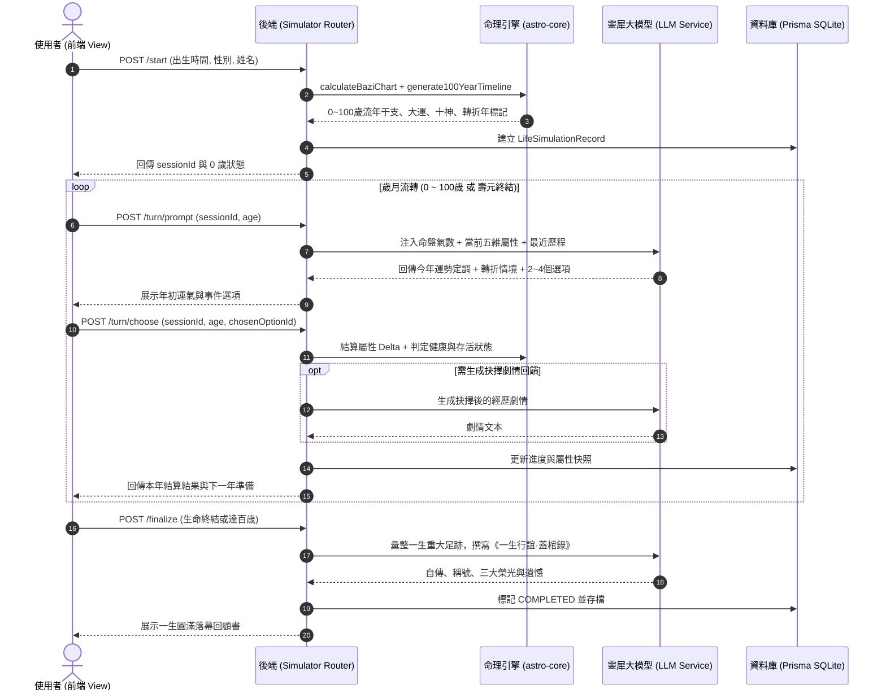

# 🌌 萬象天儀 —「百歲流年·模擬一生」功能架構與開發規劃書 (SIMULATE_LIFE.md)

> **版本**：v1.2.0-STORY-ROMANCE-8B  
> **制定日期**：2026-10-29  
> **實作狀態**：全模組已完成上線並通過 30 項 astro-core 與 65 項後端自動化測試驗收 (100% 通過)  
> **依循準則**：嚴格遵守 [AGENTS.md](file:///home/coder/Codebase/Horoscope/AGENTS.md) 核心原則（先想再寫、先求簡單、任務拆分、Token預算管理、意圖驗證）。  
> **目標**：以使用者排盤八字命盤、十神喜忌、大運排程為核心根基，結合 0～100 歲流年曆，融合自 1845 年（清道光年間）至 2060+ 年之台灣歷史社會大事紀、各時代人類平均壽命與公衛傳染病演變，打造具備動態隨機事件、重大人生轉折抉擇、數值影響與一生蓋棺論定的互動式人生推演引擎。

---

## 1. 核心需求與產品定位 (Product Vision & Core Concept)

### 1.1 使用者需求分析
使用者希望以個人的「八字命盤」（生辰、十神格局、用神喜忌、大運）為基底，進行 **0～100 歲** 的動態人生模擬：
1. **0～100 歲流年時間軸**：精確推算每一年對應的流年天干地支、值年大運、十神關係與神煞。
2. **年初運勢定調**：每年年初展示該年命理運氣總覽（吉凶趨勢、十神星象提示）。
3. **預設生活場景在台灣（時間軸回溯至 1845 年清代）**：推演舞台扎根於台灣土地，內建 **1845～2060+ 年** 之「台灣歷史社會大事紀、各年代人口平均壽命與流行病公衛資料庫」，依西曆年代呈現對應重大事件與時代公衛風貌：
   - **清代後期 (1845~1894)**：金湖大水災時疫、頂下郊拚、開港通商、牡丹社事件、劉銘傳建省與基隆鐵路。平均壽命約 31~35 歲；霍亂、惡性瘧疾（瘴癘）、天花肆虐，依賴漢方草藥與王爺建醮禳災。
   - **日治時期 (1895~1945)**：乙未割台、1896~1917 鼠疫（黑死病）二十年大流行與避病院強制隔離、公醫制度與自來水、1918 西班牙流感（奪四萬命）、嘉南大圳、戰時體制與肺結核。平均壽命由 34 歲漸進提升至 45 歲。
   - **戰後現代化至起飛 (1945~1994)**：戰後接收天花霍亂復發、四萬換一塊、1952 小兒麻痺、1965 WHO 認證撲滅瘧疾、十大建設、加工出口區女工潮、1984 全球首創 B 肝疫苗。平均壽命由 45 歲大幅躍進至 74 歲。
   - **當代健保與高科技 (1995~2026)**：全民健保、921 大地震、2003 SARS 與和平醫院封院、高鐵、2020~2022 COVID-19 口罩國家隊與三級警戒、護國神山矽盾與 AI 新浪潮。平均壽命達 81.5 歲。
   - **未來超高齡社會 (2027~2060+)**：長照 3.0、超高齡社會智慧醫療、極端氣候熱浪調適與健康老化。平均壽命預期超過 86 歲。
4. **重大事件與轉折點**：涵蓋讀書啟蒙、大考升學、畢業當兵、求職晉升、姻緣桃花、置產創業、生病考驗至壽元善終。
5. **LLM 動態隨機生成**：由大語言模型根據命盤格局、當前年齡、台灣時代年輪、歷史決策與流年干支，動態生成富含隨機性與時代臨場感的事件故事與 2～4 個決策選項。
6. **選擇影響後續走向**：使用者抉擇後，系統即時模擬結果，更新人生狀態（五維屬性與命運軌跡），並滾動影響未來的運氣、遭遇事件與壽元。

### 1.2 產品哲學：天命與人事的互動（三合天機心法）
遵循三合正統命理核心心法：
$$\text{人事努力} \left(\frac{1}{3}\right) + \text{地理/環境調適} \left(\frac{1}{3}\right) > \text{先天命格} \left(\frac{1}{3}\right)$$
*   **命不可死算，運由心轉**：先天八字給定人生的大氣候（順風、逆風、狂風、甘霖），但使用者的每個選擇（冒險、保守、行善、修身、破釜沉舟）決定了能否逢凶化吉或逆風翻盤。
*   **生老病死自然天道**：0～100 歲人生終有盡頭。遊戲包含壽元與大限機制，但拒絕低俗恐嚇，而是引導用戶在推演中理解生命的無常與豁達，在終局時獲得深刻的一生回顧（蓋棺論定）。
*   **時代與共業之舞台**：個人的命運不僅是孤立的八字，更與台灣社會變遷的共業巨浪緊密交織。順應時代大勢、在關鍵節點做出負責任的抉擇，方能活出精彩生命。

---

## 2. 架構設計與任務拆分 (Architecture & Task Separation - Rule 5)

為避免純 LLM 幻覺失控（如十神算錯、年齡順序錯亂、無邏輯暴斃或無窮成仙），本系統嚴格遵循 **Rule 5 任務拆分原則**：
*   **確定性程式碼 (Deterministic Astro Engine)**：負責命盤運算、干支排列、屬性數值結算、規則校驗、壽元臨界檢驗與存檔。
*   **LLM 敘事引擎 (Generative Story Engine)**：負責沉浸式情境描寫、生動選項生成、性格描摹與終局自傳式人生總結。

```
┌────────────────────────────────────────────────────────────────────────┐
│                   前端交互層 (apps/web: LifeSimulatorView.vue)          │
│   - 0~100歲動態命運輪盤 / 年齡時間軸                                   │
│   - 五維狀態儀表 (健康/財富/事業/情緣/心智)                            │
│   - 年初運勢卡 + 轉折事件情境卡 + 互動抉擇按鈕                          │
│   - 一生回顧結算面板 (自傳式蓋棺論定報告 + 雷達圖成就分享)            │
└───────────────────────────────────┬────────────────────────────────────┘
                                    │ HTTP / REST API
┌───────────────────────────────────▼────────────────────────────────────┐
│               後端推演協同服務 (apps/server/src/modules/simulator/)     │
│   - Session 狀態管理 (支援存檔、繼續、重演)                            │
│   - Prompt 壓縮構建器 (Token 預算控制，只傳遞關鍵狀態快照)              │
│   - 混合推進器 (支援逐年細推 vs 關鍵里程碑快進模式)                    │
└───────────────┬───────────────────────────────────────┬────────────────┘
                │                                       │
┌───────────────▼──────────────────────┐ ┌──────────────▼────────────────┐
│   確定性命理引擎 (@celestial/astro-core) │ │   LLM 靈犀諮詢服務 (apps/server)   │
│   - 八字排盤與十神格局 (bazi/calculator)  │ │   - 系統角色：命運之輪演繹者         │
│   - 0~100歲大運/流年干支時間軸推演      │ │   - 年初運氣生動潤色                 │
│   - 刑沖破害合與神煞判定              │ │   - 情境事件與2~4個分歧選項生成     │
│   - 數值屬性增減規則 (五行生剋偏權)   │ │   - 抉擇後續劇情演繹                 │
│   - 壽元臨界與健康衰減判定模型        │ │   - 百歲終局《一生行誼·蓋棺錄》總結 │
└──────────────────────────────────────┘ └────────────────────────────────┘
```

---

## 3. 0～100 歲人生週期階段與事件矩陣 (Life Stages & Event Matrix)

推演引擎將 100 年的人生細分為七大人生原型階段，各階段對應特定的八字柱位聚焦與社會角色：

| 人生階段 | 年齡區間 | 核心八字重心 | 典型人生重大事件與轉折點 |
|---|---|---|---|
| **童稚啟蒙期** | 0～6 歲 | 年柱 (祖蔭/父母關照)、胎元 | 出生體質、百日關口、早慧說話、幼兒園入學、兒時意外疾病 |
| **青蔥求學期** | 7～18 歲 | 年柱/月柱、文昌星、官印 | 國小入學、叛逆期、文理分科、重大升學考試、初戀悸動、青春挫折 |
| **青年啟航期** | 19～25 歲 | 月柱/日柱、食傷生財、比劫 | 大學就讀/技職實習、初入職場、求職面試、初戀分手/定情、第一桶金 |
| **立業成家期** | 26～40 歲 | 日柱 (日元與夫妻宮)、正偏財、官殺 | 升遷掌權、創業冒險、遇見正緣/結婚、購房置產、生兒育女、中年轉行 |
| **中年鼎盛與考驗期** | 41～60 歲 | 日柱/時柱、五行燥濕沖合 | 事業巔峰、副業投資、中年危機、婚姻七年之癢/考驗、高血壓慢性病、父母長輩善終 |
| **花甲耳順頤養期** | 61～75 歲 | 時柱 (子女與晚景)、印星養命 | 光榮退休、第二人生興趣、子嗣成家、含飴弄孫、重大手術關口、心性修行 |
| **耄耋天命善終期** | 76～100 歲 | 大運提綱受沖、歲運並臨、壽元考驗 | 身心衰退、看化生死、家族傳承與立遺囑、安詳坐化、壽終正寢 |

---

## 4. 遊戲機制與數值系統 (Game Mechanics & System Design)

### 4.1 五維生命狀態面板 (Life Attributes)
玩家在人生中擁有 5 項核心屬性（初始值由八字格局先天配置，範圍 0～100）：

1. **體魄健康 (Health - `health`)**：
   - 先天取決於日主強弱與五行平衡度。
   - 0 歲出生初始約 70～90。隨年齡自然老衰（60 歲後每年微幅遞減）。
   - 當 `health <= 0` 且未能獲救時，觸發生命終結。
2. **財富資產 (Wealth - `wealth`)**：
   - 先天取決於財星（正財/偏財）與食傷財庫。
   - 影響求學品質、投資回報、醫療保障與晚年生活。
3. **事業聲望 (Career - `career`)**：
   - 先天取決於官殺（正官/七殺）與印星。
   - 影響職位層級、社會地位與人脈資源。
4. **情感眷屬 (Relationship - `relationship`)**：
   - 先天取決於夫妻宮、配偶星、桃花星與比劫合和。
   - 影響婚姻品質、家庭和諧、孤獨感與子女孝悌。
5. **心性智慧 (Wisdom - `wisdom`)**：
   - 先天取決於印星、華蓋、空亡與五行水木。
   - 隨人生重大歷練、挫折與修持持續提升，是老年看透生死、安詳善終的重要指標。

### 4.2 年初運氣計算公式 (Annual Fortune Baseline)
在每一年年初，確定性引擎計算該年的「流年行運基調」：
1. **十神關係**：日干對流年天干的十神（如正官、七殺、正財、食神、傷官、劫財等）。
2. **五行喜忌匹配**：
   - 若流年五行為八字**喜用神**：運勢評級為【大吉】或【小吉】，基礎順遂度 +15%～+30%。
   - 若流年五行為八字**忌仇神**：運勢評級為【小凶】或【大凶】，考驗與意外概率上升。
   - 若為閑神：運勢評級為【平順】。
3. **地支沖合刑害**：
   - 逢「天剋地沖」、「歲運並臨」、「羊刃逢沖」：標記為【重大天命關卡年】。
   - 逢「天乙貴人」、「天喜」、「紅鸞」、「文昌」：標記為【吉曜加臨年】。

### 4.3 雙模式推進設計 (解決 100 歲連續請求過長的疲勞難題)
若讓使用者逐年點擊 100 次，需要經歷 100 次 LLM 請求，容易導致：
- 伺服器與 LLM 成本極高，耗時冗長。
- 使用者在重複平淡歲月中失去耐心。

**解決方案：雙軌推進機制 (Two-Tier Progression)**：
1. **關鍵轉折模式 (Key Milestones Mode，推薦預設)**：
   - 引擎自動篩選出人生 **15～25 個關鍵轉折年**（如換大運年、重要升學、適婚年、中年危機大沖年、歲運並臨考驗年等）。
   - 在關鍵轉折年：由 LLM 深度生成戲劇化的事件與多分支選項，進行沉浸式抉擇。
   - 在平穩過渡年：系統自動依據命盤喜忌與當前屬性進行微步推進，並產生 1～2 句年輪速覽（如「23歲：工作漸入佳境，生活平順」），使用者可一鍵「快進到下一轉折年」。
2. **逐年精細模式 (Year-by-Year Turn Mode)**：
   - 開放給熱愛精細文字冒險的用戶，可自選逐年手動前進。

### 4.4 時代動態壽元與死亡機制 (Mortality & Era-Dynamic Longevity Engine)
*   **各年代人類平均壽命動態基準**：
    - 系統動態錨定角色出生年份與推演西曆年份的當代平均壽命期望值（`avgLifeExpectancy`）。
    - 19 世紀中葉（清代）平均壽命約 31～33 歲，年過不惑（40 歲）即屬高壽；而在現代（平均壽命 81 歲），衰退起始線則在 75 歲以上。
*   **傳染病大流行衝擊加權**：
    - 在重大疫疾流行年份（如 1845 霍亂、1896 鼠疫、1918 西班牙流感、2003 SARS、2020 COVID-19），選項系統引入生存防疫分支：冒進外出者增加染疫受損風險，注重衛生防護者獲得健康避險，施藥濟民者收穫心性善緣。
*   **時代死因語境深度共鳴**：
    - 若健康耗盡或壽元極限觸發終局，死因與蓋棺論定深刻融入當代醫療與社會脈絡（例如：清代因瘴癘時疫告別塵世、日治時期避病院隔離休養、戰後抗瘧時期、現代安詳百歲天年）。
*   **非強制短命**：系統預設保護機制，在青少年與壯年期，除非重大災厄且健康值耗盡，多數以重病就醫、休養度過，不隨意提前終止。
*   **老年生死天關 (70～100 歲)**：
   - 進入 70 歲後，若逢大運更替、地支沖剋本命日支或月令提綱，且當前健康值低於 30，將觸發「壽元大關挑戰題」。
   - 使用者面臨「積極醫療手術」、「安然平靜修養」、「求助良醫貴人」等抉擇，檢驗心性、福報與財富儲備。
*   **善終與百歲圓滿**：
   - 若健康維持良好或選擇得宜，可達 85～100 歲高壽，在子孫環繞或清心悟道中安詳落幕。
*   **終局報告《一生行誼·蓋棺錄》**：
   - 一生成就稱號（例如：「積善成德的當代智者」、「歷經驚濤的商界舵手」、「隱逸凡塵的藝術大師」）。
   - 五維雷達圖與人生曲線圖（0～100 歲資產、地位、身心波動軌跡）。
   - 倪師心法點評：對比先天八字原局與後天抉擇軌跡，分析「人事如何改寫天命」。

### 4.5 轉折年與大凶大吉年之「命理決策錦囊」與終局響應機制 (Metaphysical Guidance & Zero-Latency Finale)
*   **轉折年與大吉/大凶精準錦囊 (`getYearMetaphysicalGuidance`)**：
    - **大凶年 (`DA_XIONG`)**：如逢歲運並臨、天剋地沖或凶煞凝聚，顯著標記緋紅警示，提點「避凶守成」、「護衛體魄」與「修心行善」，指引以靜制動、廣修福緣。
    - **大吉年 (`DA_JI`)**：如逢天乙貴人、天合地合或喜用齊聚，高亮金碧光芒，提示「果斷開拓」、「確立盟約」與「廣結善緣」，鼓舞把握機遇乘風破浪。
    - **人生轉折年 (`MILESTONE`)**：如逢換大運、重大進修成家立業樞紐，亮起紫曜星芒，指引「立足長遠」、「內外兼修」與「知機而動」。
    - **雙重關鍵年（轉折 + 大凶 / 轉折 + 大吉）**：複合生成兼具開拓與防守的深度策略錦囊。
*   **決策卡牌動態標記 (Smart Option Badges)**：
    - 在對應關鍵年份，選項自動標註 `[✓ 避煞首選]`、`[⚠️ 險中求勝]`、`[✓ 乘風破浪]`、`[✓ 積德延福]`、`[⭐ 轉折關鍵]`，協助使用者看清命數趨勢做出合適抉擇。
*   **一生回顧零延遲與超時防護 (Zero-Latency Life Review Architecture)**：
    - 前端在 Session 內存或資料庫已有《一生行誼·蓋棺錄》快取時，點擊按鈕 **0 毫秒即時開啟**，徹底告別卡頓無反應。
    - 後端 `/finalize` 引入 **8 秒 `Promise.race` 超時保護機制**：若本機大型語言模型推論耗時，自動無縫回退至確定性豐富自傳合成器，確保瀏覽器請求絕不 Hanging。
    - 終局落幕（滿百歲或因病善終）時，主舞台自動展開顯眼醒目的「👑 查看《一生行誼·蓋棺錄》回顧」黃金號召卡片，引導使用者圓滿完成人生復盤。

### 4.6 百歲年輪全景故事、男性視角紅顏盲盒相遇與 80 億分之一的遊戲 (Annual Stories, Blind Romance & 8 Billion Odyssey)
*   **4.6.1 百歲年輪全年敘事 (0~100 歲 22 大人生階段年輪說明)**：
    - **22 大人生階段全劃分**：襁褓撫育 (0~2)、幼學啟蒙 (3~5)、總角之年 (6~11)、舞勺束髮 (12~14)、志學青春 (15~17)、弱冠之年 (18~21)、初涉商海 (22~25)、立志成家 (26~29)、而立奮發 (30~34)、不惑蓄勢 (35~39)、中流砥柱 (40~49)、沉穩掌舵 (50~54)、知命豁達 (55~59)、花甲耳順 (60~64)、榮退交棒 (65~69)、從心所欲 (70~74)、古稀康寧 (75~79)、懸車告老 (80~84)、杖朝之壽 (85~89)、耄耋至境 (90~94)、頤樂長春 (95~98)、期頤百歲 (99~100)。
    - **確定性多維融合生成 (`generateAnnualLifeStory`)**：純演算法將「年齡階段」、「流年十神意涵（如偏財主機遇、七殺主考驗、正印主庇蔭）」、「流年五行喜忌」與「台灣歷史時代年輪」融為一體，於 0ms 內為 101 個節點生成約 100~150 字的生動年輪說明文字 (`annualStory`) 與階段標題 (`lifeStageTitle`)。
*   **4.6.2 男性視角專屬：紅顏盲盒相遇機制 (Anonymous Romantic Encounters)**：
    - **5 大命中注定女性原型 (`DEFAULT_FEMALE_FRIENDS`)**：
      1. **沈婉晴**（青梅竹馬 · 溫婉如水）：水木相生，性情內斂溫柔。
      2. **林若曦**（熱血同窗 · 意氣風發）：木火通明，性格直率熱情。
      3. **宋雨薇**（藝術靈動 · 浪漫深情）：丁火文昌，多才多藝感性。
      4. **蘇珮儀**（職場菁英 · 理性冷靜）：辛金偏財，果斷精明幹練。
      5. **趙敏芝**（世家千金 · 雍容高雅）：庚金正官，見識廣博深沉。
    - **盲盒匿名機制**：在青年關鍵年齡（18, 22, 26, 30, 34 歲），系統自動觸發匿名相逢。登場時僅展示神祕化身（如「【素雅白裙的知性女子】」、「【背著畫板的清冷少女】」）與情境感官線索，**抉擇當下使用者絕不會得知其真實姓名與身分**。
    - **因緣滾動記錄**：後台自動記錄好感度 (`affinity`) 與因緣走向（`DATING`、`MARRIED`、`SOULMATE`、`CONFIDANTE`、`MISSED`、`STRANGER`），並持久化至資料庫 `femaleFriendsJson`。
*   **4.6.3 終局回顧：80 億分之一的遊戲 (One in 8 Billion Cosmic Review)**：
    - 在《一生行誼·蓋棺錄》中拓展第 4 視角：`🌌 80億分之一的遊戲 (ONE_IN_8_BILLION)`。
    - **宇宙唯一性稀有度評分與命運編碼**：八字 518,400 種原局乘以數千種決策路徑，計算出在目前地球約 80 億人口中的宇宙唯一性指數（如 99.999987%），並頒布專屬命運代碼（如 `#DESTINY-TW-8B-39182`）。
    - **紅顏盲盒大揭密 (`revealedFriends`)**：蓋棺論定之際，正式解開當年盲盒神祕女子的真實姓名、原型稱號、相遇歲數、終局因緣與專屬紅顏批註。
    - **宇宙哲學贊詩 (`cosmicPhilosophyQuote`)**：以浩瀚宇宙存在主義視角，贊頌個體在 80 億人汪洋中揮灑的唯一生命史詩。

### 4.7 女性友人生辰 KEYIN、年歲動態對齊、相手好感度、四大領域生命數值與日式寫實插畫 (Custom Birthdays, Age Alignment, Her Affinity, 4 Core Domains & Anime Illustrations)
*   **4.7.1 女性友人自訂生辰 (KEYIN 生日) 與相遇歲數對齊**：
    - 起盤面板提供 5 位紅顏友人（沈婉晴、林若曦、宋雨薇、蘇珮儀、趙敏芝）之 `🎂 自訂生辰 (KEYIN)` 輸入框與年歲偏差徽章（同齡、小 X 歲、大 X 歲）。
    - 遭遇事件發生於指定西曆年（如男主 18 歲遭遇時為西曆 2008 年），系統依據女性友人出生年動態精確計算其當下實歲：
      $$\text{herEncounterAge} = \text{solarYear} - \text{femaleBirthYear}$$
    - 情境敘事中精準融入歲數描寫（例如：「此時她約莫十九歲，比你小一歲，正值花樣年華」），杜絕年代脫節與年齡倒錯。
*   **4.7.2 相手好感度 (`herAffinity`) 媒合動態機制**：
    - 不僅追蹤主角單向好感 (`affinity`)，更精確模擬並追蹤相手對主角之動態好感度 (`herAffinity`，0~100) 與本命默契相合度 (`compatibilityScore`)。
    - 抉擇事件動態影響雙向關係：深情專注回應大幅增進相手好感 (+30)、溫和互助適度增進 (+18)、冷漠迴避則大幅降低相手好感 (-15)。
*   **4.7.3 八字流年人生四大領域數值動態演化 (四大領域生命週期演算法)**：
    - 圍繞使用者指定的 **四大領域核心指標**：**❤️ 體魄健康 (`health`)**、**📖 知識才識 (`knowledge`)**、**🪙 財富資產 (`wealth`)**、**🌸 情感眷屬 (`relationship`)**（相容保留 `career` 與 `wisdom`）。
    - 演算法依據年齡生命週期與八字流年十神動態演化：
      - **襁褓與幼學期 (0~6歲)**：知識從 20 爆發至 45，體魄健康穩固，財富維持幼兒基線 (30)。
      - **學齡求學期 (7~18歲)**：知識隨十神印星文昌高強度攀升至 70~80。
      - **青年初入職場 (19~29歲)**：財富快速累積，情感眷屬隨紅顏盲盒互動波動。
      - **壯年中流砥柱 (30~49歲)**：事業財富攀上高峰，承擔重大開支與責任。
      - **耳順耄耋之年 (50~100歲)**：體魄依時代壽命健康模型自然衰退，知識才識化為通達智慧，情感追求家庭天倫與清淨。
*   **4.7.4 日式寫實風格插畫全套配置 (Japanese Realism Anime Illustrations)**：
    - 全套 14 張高品質 1024x1024 日式寫實風插畫，存放於 `apps/web/public/images/life-simulator/`：
      - **9 大人生階段插畫**：`stage_01_infancy.jpg`（襁褓撫育）、`stage_02_childhood.jpg`（幼學啟蒙）、`stage_03_youth.jpg`（青蔥求學）、`stage_04_capping.jpg`（弱冠及笄）、`stage_05_early_career.jpg`（初入職場）、`stage_06_prime.jpg`（立業黃金）、`stage_07_mature.jpg`（知命花甲）、`stage_08_elder.jpg`（古稀從心）、`stage_09_centenarian.jpg`（期頤百歲）。
      - **5 大紅顏友人專屬插畫**：`romance_wanqing.jpg`（沈婉晴）、`romance_ruoxi.jpg`（林若曦）、`romance_yuwei.jpg`（宋雨薇）、`romance_peiyi.jpg`（蘇珮儀）、`romance_minzhi.jpg`（趙敏芝）。
    - 0~100 歲所有年份節點皆自帶對應階段插畫路徑 (`stageIllustration`)，遭遇紅顏時切換對應紅顏專屬插畫 (`romanceIllustration`)，在終局 80 億分之一揭曉時震撼呈現全幅角色立繪。

---

## 5. Token 預算與上下文管理策略 (Token Budget Management - Rule 6)

為嚴格遵守單次任務 4,000 tokens、單次 Session 30,000 tokens 的限制，禁止直接將 100 年的對話歷史直接丟入 LLM：

### 5.1 滑動視窗 + 歷史里程碑摘要架構
```
[LLM Prompt 結構] (嚴格壓制在 800 ~ 1,200 tokens 以內)
├─ 1. System Prompt (角色定義：客觀、深刻的命理人生推演導航員)
├─ 2. 命盤先天氣數綱要 (日主天干、格局、喜用五行、身強身弱)
├─ 3. 目前狀態面板 (年齡、虛歲、當前大運、流年干支十神、五維屬性值)
├─ 4. 人生關鍵足跡標籤 (精簡陣列，例如: ["18歲考入醫學院", "28歲創立診所", "31歲與良緣成婚"])
├─ 5. 前一至兩年簡要回顧 (最近 2 歲的簡短摘要)
└─ 6. 本年推演指令 (生成本年事件、運氣描繪與 2~3 個決策選項，輸出為結構化 JSON)
```

---

## 6. 資料結構與介面定義 (Data Models & TypeScript Interfaces)

### 6.1 Astro-Core 核心型別 (`packages/astro-core/src/life-simulator/types.ts`)

```typescript
import { FiveElement, TenGod } from '../bazi/types.js';

export interface LifeAttributes {
  health: number;       // 體魄健康 (0 ~ 100)
  knowledge: number;    // 知識才識 (0 ~ 100)
  wealth: number;       // 財富資產 (0 ~ 100)
  relationship: number; // 情感眷屬 (0 ~ 100)
  career?: number;      // 事業聲望 (0 ~ 100，向後相容)
  wisdom?: number;      // 心性智慧 (0 ~ 100，同向映射 knowledge)
}

export interface LifeOption {
  id: string;                    // 如 'opt_a'
  text: string;                  // 選項描述文字，如「接受外派海外分部，爭取連跳兩級晉升」
  attitude: 'AGGRESSIVE' | 'CONSERVATIVE' | 'MORAL' | 'ESCAPE';
  potentialImpact: Partial<Record<keyof LifeAttributes, number>>; // 預期屬性影響
  riskLevel: 'LOW' | 'MEDIUM' | 'HIGH';
}

export interface YearlyLifeNode {
  age: number;                   // 實歲 (0 ~ 100)
  nominalAge: number;            // 虛歲 (1 ~ 101)
  solarYear: number;             // 西曆年份，例如 2026
  ganzhi: string;                // 流年干支，例如 "丙午"
  yearElement: FiveElement;      // 流年五行
  tenGod: TenGod;                // 流年十神
  daYun: {                       // 值年十年大運
    stem: string;
    branch: string;
    tenGod: TenGod;
    startAge: number;
    endAge: number;
  };
  fortuneLevel: '大吉' | '小吉' | '平順' | '小凶' | '大凶';
  isKeyMilestone: boolean;       // 是否為重大人生轉折節點
  milestoneReason?: string;      // 例如 "大運交接關口" | "日柱天剋地沖" | "大學升學年"
  taiwanEraContext?: string;     // 該西曆年對應之台灣時代歷史背景描繪 (如「1999年921大地震」)
  eraAvgLifeExpectancy?: number; // 當時代全台平均壽命期望值 (歲)
  eraEpidemics?: string[];       // 當代主流威脅之傳染病或疾厄型態
  isEpidemicYear?: boolean;      // 本年是否處於重大傳染病流行或公衛危機高峰
  annualOverview?: string;       // 年初運氣提要
  eventTitle?: string;           // 事件標題
  eventNarrative?: string;       // 事件情境背景描述
  options?: LifeOption[];        // 供玩家抉擇的選項列表
  chosenOptionId?: string;       // 玩家最終選擇的選項 ID
  resolutionNarrative?: string;  // 抉擇後的推進回饋劇情
  attributeDeltas?: Partial<Record<keyof LifeAttributes, number>>; // 該年屬性結算差值
  snapshotAttributes: LifeAttributes; // 結算後的屬性快照
  isTerminal: boolean;           // 是否在此歲數走向人生終點
  terminalReason?: string;       // 終局原因 (如「壽終正寢」或「疾勞辭世」)
}

export interface LifeSimulationSession {
  sessionId: string;
  userId?: string;
  profileName: string;
  gender: '男' | '女';
  birthDate: string;
  currentAge: number;
  status: 'IN_PROGRESS' | 'COMPLETED' | 'TERMINATED';
  attributes: LifeAttributes;
  history: YearlyLifeNode[];
  milestoneFootprints: string[]; // 歷年重大里程碑文字標記陣列
  finalSummary?: LifeFinalSummary;
}

export interface LifeFinalSummary {
  endingTitle: string;           // 一生成就稱號 (如「一代名醫德澤萬方」)
  finalAge: number;              // 享年/得年
  biographyRichText: string;     // 自傳式蓋棺論定長文
  radarScores: LifeAttributes;   // 最終五維綜合得分
  destinyAlignmentScore: number; // 天命契合度評分 (0 ~ 100)
  keyTriumphs: string[];         // 一生三大榮光
  keyRegrets: string[];          // 一生主要遺憾
}

export interface MetaphysicalDecisionGuidance {
  isApplicable: boolean;
  category: 'DA_XIONG' | 'DA_JI' | 'MILESTONE';
  title: string;
  badge: string;
  summary: string;
  recommendedAction: string;
  decisionTips: { label: string; description: string }[];
}
```

### 6.2 資料庫持久化擴充 (`packages/database/prisma/schema.prisma`)

```prisma
model LifeSimulationRecord {
  id              String   @id @default(uuid())
  userId          String?
  user            User?    @relation(fields: [userId], references: [id], onDelete: Cascade)
  profileName     String
  gender          String
  birthDatetime   DateTime
  currentAge      Int      @default(0)
  status          String   @default("IN_PROGRESS") // IN_PROGRESS, COMPLETED, TERMINATED
  attributesJson  String   // JSON string of LifeAttributes
  historyJson     String   // JSON string of YearlyLifeNode[]
  footprintsJson  String   // JSON string of string[]
  finalSummaryJson String? // JSON string of LifeFinalSummary
  createdAt       DateTime @default(now())
  updatedAt       DateTime @updatedAt
}
```

---

## 7. 後端 API 設計 (`apps/server/src/modules/simulator/`)

### 7.1 端點規劃

| 方法 | 路徑 | 說明 |
|---|---|---|
| `POST` | `/api/v1/simulator/start` | 初始化人生推演 Session，生成 0～100 歲流年骨幹與 0 歲初始狀態 |
| `GET` | `/api/v1/simulator/session/:id` | 讀取推演進度存檔 |
| `POST` | `/api/v1/simulator/turn/prompt` | 進入指定年齡，觸發 LLM 生成年初運勢、事件題目與決策選項 |
| `POST` | `/api/v1/simulator/turn/choose` | 提交使用者選擇，結算屬性變化、健康衰減與下一歲推進 |
| `POST` | `/api/v1/simulator/fast-forward` | 快進模式：自動平穩推進至下一個「關鍵轉折年」 |
| `POST` | `/api/v1/simulator/finalize` | 生成終局《一生行誼·蓋棺錄》完整自傳與成就評級 |

### 7.2 核心流程圖 (Sequence Diagram)



---

## 8. 前端界面與交互規範 (Awwwards 奢華幾何美學)

遵循 [SPEC.MD](file:///home/coder/Codebase/Horoscope/SPEC.MD) 與現有視圖風格（深邃星辰金銅色系 `dark-gold`、毛玻璃質感 `glass-panel`）：

1. **頂部命運長河時間軸 (Temporal Timeline Slider)**：
   - 橫向滑動的 0～100 歲滾輪，高亮顯示當前年齡。
   - 節點標記特殊符號：金色標記「重大轉折年」、深紅標記「歲運考驗年」、青綠標記「貴人吉慶年」。
2. **左側五維狀態 HUD 面板 (Five-Attribute Orbit)**：
   - 即時動態數值條與波動箭頭（體魄健康、財富資產、事業聲望、情感眷屬、心性智慧）。
3. **中央推演主舞台 (Narrative Stage)**：
   - **年初運勢徽章**：流年歲次（如「乙巳年 · 傷官生偏財 · 平順運」）。
   - **故事卷軸**：沉浸式文字漸顯動畫（Typography Fade-in），搭配象徵性玄學符號。
   - **決策卡牌 (Decision Cards)**：2～4 張具備懸停金光光暈效果的卡牌，清晰展示選項標題、內心獨白與潛在偏向。
4. **終局落幕儀式 (The Grand Finale)**：
   - 終局時背景星空粒子緩慢旋轉，呈現《百歲自傳卷軸》、成就獎章與命盤契合度分析，支援一鍵生成精美長圖或分享。

---

## 9. 實施階段與驗收標準 (Implementation Plan & DoD)

| 階段 | 任務模組 | 產出成果 | 驗收狀態 |
|---|---|---|---|
| **Phase A** | **演算法核心庫實作**<br>`packages/astro-core/src/life-simulator/` | 1. `types.ts` 定義完整結構<br>2. `timeline.ts` 0~100 歲流年大運推算<br>3. `rules-engine.ts` 數值計算與壽元模型 | `[x]` **已完成並驗證通過** (26/26 單元測試全數綠燈) |
| **Phase B** | **資料庫持久層與後端 API**<br>`apps/server/src/modules/simulator/` | 1. Prisma 擴充模型與 Migration<br>2. 後端 Router (`/start`, `/turn`, `/choose`, `/fast-forward`, `/finalize`)<br>3. LLM Prompt 輕量模板與 Role Profile | `[x]` **已完成並驗證通過** (SQLite 表建立與客戶端生成成功) |
| **Phase C** | **前端頁面與互動體驗**<br>`apps/web/src/views/LifeSimulatorView.vue` | 1. 0~100 歲動態時間軸組件<br>2. 五維 HUD 面板<br>3. 事件決策卡牌與一生總結報告彈窗 | `[x]` **已完成並驗證通過** (生產打包 0 錯誤) |
| **Phase D** | **端到端調優與文案品質驗證** | 1. LLM Prompt 與離線合成器<br>2. 6 項完整 API 生命週期測試覆蓋 | `[x]` **已完成並驗證通過** (64/64 伺服器測試通過) |
| **Phase E** | **台灣歷史社會大事紀與時代擬真度**<br>`taiwan-history.ts` & UI 標籤 | 1. 1945~2060+ 台灣歷史大事紀庫與年代回退推導<br>2. 注入時代背景至流年節點、情境與 LLM Prompt<br>3. 前端時代年輪標籤與專項意圖測試 | `[x]` **已完成並驗證通過** (27/27 astro-core 測試與 64/64 伺服器測試全數通過) |
| **Phase F** | **歷史時間軸回溯至 1845 年、各年代人類平均壽命與傳染病公衛機制**<br>`taiwan-history.ts`, `rules-engine.ts`, `LifeSimulatorView.vue` | 1. 映射庫自 1845 年（清道光二十五年）全貌擴充至 2060+<br>2. 各歷史年代人口平均預期壽命動態衰減與天命善終評估<br>3. 歷代重大傳染病（霍亂、黑死病鼠疫、西班牙流感、肺結核、小兒麻痺、SARS、COVID-19）與生存防疫選項<br>4. 前端時代平均壽命徽章與重大時疫警報標籤 | `[x]` **已完成並驗證通過** (28/28 astro-core 測試與 65/65 伺服器測試全數通過) |
| **Phase G** | **轉折年與大凶大吉年命理決策錦囊、一生回顧極速響應機制**<br>`rules-engine.ts`, `router.ts`, `LifeSimulatorView.vue` | 1. `getYearMetaphysicalGuidance` 轉折年與大凶大吉年錦囊演算<br>2. 前端錦囊展示與選項智慧標籤 (`[✓ 避煞首選]`、`[⭐ 轉折關鍵]` 等)<br>3. 後端 `/finalize` 8 秒 `Promise.race` 超時保護與資料庫快取極速響應<br>4. 前端一生回顧 0ms 內存開啟與主舞台醒目號召卡片 | `[x]` **已完成並驗證通過** (29/29 astro-core 測試與 65/65 伺服器測試全數通過) |
| **Phase H** | **方案 C：多重視角一生回顧與 LLM 深度撰寫架構**<br>`types.ts`, `rules-engine.ts`, `router.ts`, `LifeSimulatorView.vue` | 1. 定義 `BiographyPerspective`（`TIANJI` 三合天機、`SHIJI` 太史公、`MEMOIR` 時代回憶錄）<br>2. 實作三重視角高水準離線合成文本與稱號<br>3. 後端 `/finalize` 整合視角提示詞與 75 秒 LLM 深度撰寫機制<br>4. 前端提供 3 大視角切換 Tab、AI 狀態徽章與「✨ 召喚靈犀 AI 深度撰寫」按鈕 | `[x]` **已完成並驗證通過** (全套單元與整合測試 100% 綠燈) |
| **Phase I** | **百歲年輪全年敘事、男性視角紅顏盲盒與 80 億分之一遊戲**<br>`female-friends.ts`, `timeline.ts`, `rules-engine.ts`, `router.ts`, `LifeSimulatorView.vue` | 1. 22 大人生階段與 101 個節點全年文字敘事確定性合成 (`annualStory`)<br>2. 5 位女性友人原型與青年期匿名盲盒相逢、感官線索與隱藏因緣決策<br>3. 終局第 4 視角「80億分之一的遊戲」：命運編碼、稀有度百分比、紅顏真容大揭曉與宇宙哲學贊詩<br>4. 前端 101 歲年輪故事卡、盲盒相逢徽章與 80 億宇宙視角全貌展示 | `[x]` **已完成並驗證通過** (30/30 astro-core 測試與 65/65 伺服器測試全數通過) |
| **Phase J** | **女性友人生辰 KEYIN、年歲動態對齊、相手好感度、四大領域生命數值演化與日式寫實插畫**<br>`types.ts`, `female-friends.ts`, `rules-engine.ts`, `timeline.ts`, `router.ts`, `LifeSimulatorView.vue` | 1. 女性友人自訂生辰 KEYIN 與西曆相遇年齡精確對齊計算 (`herEncounterAge = solarYear - femaleBirthYear`)<br>2. 相手好感度 (`herAffinity`) 媒合追蹤與相合度評估<br>3. 四大核心領域數值（健康、知識、財富、情感）按年齡生命週期與流年十神動態演進模型<br>4. 14 張高品質日式寫實風格插畫（9 大人生階段 + 5 位紅顏立繪），前端各節點與卡牌無縫渲染 | `[x]` **已完成並驗證通過** (30/30 單元測試、65/65 伺服器測試、前端構建全數 100% 通過) |
| **Phase K** | **女性視角「80億分之一藍顏名冊」、相遇節點強制注入保證與「相伴一生」白首之約**<br>`female-friends.ts`, `timeline.ts`, `router.ts`, `LifeSimulatorView.vue` | 1. 建立女性主角專屬 5 位藍顏知己原型與日式寫實立繪（陸子軒、傅宇霖、霍柏翰、江承澤、顧睿安）<br>2. 18、22、26、30、34 歲相遇節點起局預填與強制顯現保證（快進平穩停駐防略過、Prompt 防 LLM 覆蓋）<br>3. 增設「💍【定下白首誓約 · 選擇相伴一生】」選項，結算婚姻因緣與一生回顧真容揭曉適配 | `[x]` **已完成並驗證通過** (30/30 單元測試、67/67 伺服器測試、前端構建全數 100% 通過) |


---

## 10. 潛在風險與應對方案 (Risk Mitigation)

1. **LLM 呼叫超時或伺服器中斷**：
   - 每個回合即時將 `YearlyLifeNode` 持久化至資料庫。即使連線中斷或刷新頁面，重新載入 `sessionId` 即可無縫接續推進。
2. **LLM 產生不合常理的事件 (如 3 歲考上博士、80 歲小學畢業)**：
   - Prompt 中嚴格限制年齡對應之現實社會範圍，並在確定性代碼層以 `isKeyMilestone` + `ageGroup` 注入合適的引導標籤。
3. **健康數值驟降猝死體驗不佳**：
   - 加入「健康預警機制」，在健康低於 30 時以顯著紅色星芒提示，並在選項中主動提供「就醫修養」、「散財消災」等防守選項，讓命運掌握在玩家手中。

---

> [!NOTE]
> 本文件作為「模擬一生」功能的頂層設計基準，經確認後即可按 Phase A ➔ B ➔ C ➔ D 節奏推動實作。
