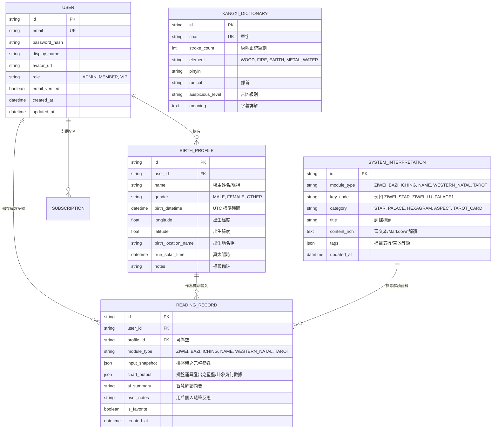

# 🌌 萬象天儀 (Astraea & CelestialDao) — 綜合星象與命理系統規格書 (SPEC.MD)

> **版本**：v1.0.0-PROD-SPEC  
> **設計等級**：Awwwards / Webby Awards / FWA Site of the Day 級別視覺與交互體驗  
> **核心架構**：東西方雙軌星象命理引擎 + 沉浸式 3D/WebGL 交互 + Node.js 企業級後端與後台管理  

---

## 目錄 (Table of Contents)
1. [系統總覽與願景 (System Overview & Vision)](#1-系統總覽與願景-system-overview--vision)
2. [技術架構與選型 (Architecture & Tech Stack)](#2-技術架構與選型-architecture--tech-stack)
3. [核心命理與星象引擎規格 (Core Divination & Astrology Modules)](#3-核心命理與星象引擎規格-core-divination--astrology-modules)
   - 3.1 [東方命理：紫微斗數系統 (Zi Wei Dou Shu)](#31-東方命理紫微斗數系統-zi-wei-dou-shu)
   - 3.2 [東方命理：四柱八字論命系統 (BaZi Four Pillars)](#32-東方命理四柱八字論命系統-bazi-four-pillars)
   - 3.3 [東方玄學：周易卜卦系統 (I Ching Divination)](#33-東方玄學周易卜卦系統-i-ching-divination)
   - 3.4 [東方玄學：姓名學與命名系統 (Name Analysis & Recommendation)](#34-東方玄學姓名學與命名系統-name-analysis--recommendation)
   - 3.5 [西方星象：西洋本命星盤與月亮星座 (Western Astrology & Moon Sign)](#35-西方星象西洋本命星盤與月亮星座-western-astrology--moon-sign)
   - 3.6 [西方神秘學：塔羅牌占卜系統 (Tarot Divination)](#36-西方神秘學塔羅牌占卜系統-tarot-divination)
4. [Awwwards/FWA 等級視覺與 UX 規範 (Elite Design System)](#4-awwwardsfwa-等級視覺與-ux-規範-elite-design-system)
   - 4.1 [色彩哲學與雙主題系統 (Dual Cosmic Theme)](#41-色彩哲學與雙主題系統-dual-cosmic-theme)
   - 4.2 [排版字體與幾何美學 (Typography & Sacred Geometry)](#42-排版字體與幾何美學-typography--sacred-geometry)
   - 4.3 [3D 交互、流體動態與物理渲染 (WebGL & Kinetic Motion)](#43-3d-交互流體動態與物理渲染-webgl--kinetic-motion)
5. [資料庫與後端架構規格 (Database & Backend Architecture)](#5-資料庫與後端架構規格-database--backend-architecture)
   - 5.1 [E-R 核心實體關聯模型 (Data Schema)](#51-e-r-核心實體關聯模型-data-schema)
   - 5.2 [RESTful & GraphQL API 規範](#52-restful--graphql-api-規範)
   - 5.3 [天文與曆法精確度保證 (真太陽時與天文曆算)](#53-天文與曆法精確度保證-真太陽時與天文曆算)
6. [會員中心與個人命盤檔案庫 (Member Portal & Chart Vault)](#6-會員中心與個人命盤檔案庫-member-portal--chart-vault)
7. [管理後台管理系統規格 (Admin CMS Portal)](#7-管理後台管理系統規格-admin-cms-portal)
8. [Docker 容器化與部署規格 (Containerization & Deployment Architecture)](#8-docker-容器化與部署規格-containerization--deployment-architecture)
   - 8.1 [多階段建構策略 (Multi-Stage Dockerfile)](#81-多階段建構策略-multi-stage-dockerfile)
   - 8.2 [Docker Compose 全棧編排規格 (Full-Stack Orchestration)](#82-docker-compose-全棧編排規格-full-stack-orchestration)
   - 8.3 [環境配置與啟動指令 (.env & One-Click Launch)](#83-環境配置與啟動指令-env--one-click-launch)
9. [實施路徑與開發里程碑 (Implementation Roadmap)](#9-實施路徑與開發里程碑-implementation-roadmap)

---

## 1. 系統總覽與願景 (System Overview & Vision)

### 1.1 產品定位
「萬象天儀 (CelestialDao / Astraea)」是一座融匯**東方干支星命（紫微斗數、四柱八字、周易文王卦、易經姓名學）**與**西方占星神秘學（本命星盤、月相原型、78張韋特塔羅）**的頂級星象靈性數字殿堂。

傳統命理網站普遍存在界面簡陋、充斥大量雜亂廣告、計算公式殘缺等問題。本系統以 **Awwwards / Webby Awards / FWA Site of the Day** 得獎標準打造，透過現代 WebGL/Three.js 渾天儀與 3D 塔羅牌洗牌物理渲染，將千年玄學昇華為極具藝術美感與嚴謹數學精確度的數位交互體驗。

### 1.2 目標受眾
1. **玄學與占星愛好者**：追求精確度排盤（真太陽時校正、 Swiss Ephemeris 恆星曆庫支持）的高階使用者。
2. **尋求命理指引與命名建議的大眾**：渴望獲得具有深度文化底蘊、優美文字解讀、新生兒喜用神命名建議的用戶。
3. **注重視覺品味的現代族群**：熱愛現代高級藝術設計（Editorial Luxury Aesthetics）、沉浸式互動氛圍的年輕世代。

---

## 2. 技術架構與選型 (Architecture & Tech Stack)

```
┌────────────────────────────────────────────────────────────────────────┐
│                        前端展示層 (Frontend Client)                    │
│   Vue 3 (Composition API) + TypeScript + Vite / Nuxt 3                │
│   Tailwind CSS + Three.js / WebGL + GSAP + Lenis Smooth Scroll        │
│   Pinia (狀態管理) + Vue Router + VueUse                              │
└─────────────────────────────────┬──────────────────────────────────────┘
                                  │ HTTPS / WSS / JWT
┌─────────────────────────────────▼──────────────────────────────────────┐
│                        API 網關層與後端應用服務 (Backend)              │
│   Node.js (TypeScript) + Express / Fastify 企業級分層架構              │
│   - Auth 認證 (JWT, Argon2, Google OAuth2)                             │
│   - 曆法與天文核心運算微服務 (Swiss Ephemeris, Lunar Engine)           │
│   - AI 輔助命理大模型解盤介面 (LLM Fallback & Interpretation Enhancer)│
└─────────────────────────────────┬──────────────────────────────────────┘
                                  │
┌─────────────────────────────────┼──────────────────────────────────────┐
│  資料持久層 (Data Layer)        │  外部服務與微核心 (Micro-Engines)     │
│  - PostgreSQL (主關聯資料庫)     │  - Swiss Ephemeris (天文行星坐標計算) │
│  - Prisma ORM (型別安全 ORM)    │  - 康熙字典字庫與五行筆劃數據庫        │
│  - Redis (排盤快取、Rate Limit) │  - 經緯度真太陽時 (True Solar Time)   │
└─────────────────────────────────┴──────────────────────────────────────┘
```

### 2.1 前端技術棧
- **核心框架**：Vue 3 (SFC `<script setup>`, TypeScript 5.x)
- **構建工具**：Vite 5+ 或 Nuxt 3 (SSR/SSG 最利於 SEO 與流暢首屏渲染)
- **狀態管理**：Pinia 2.x
- **樣式與設計系統**：Tailwind CSS 3.4+ / PostCSS + 自定義 CSS 變量流動光影
- **3D 與動畫管線 (Awwwards 規格標配)**：
  - **Three.js / WebGL**：渲染 3D 渾天星球 (Celestial Astrolabe)、黃道十二宮環、粒子星河
  - **GSAP (GreenSock) + ScrollTrigger**：絲滑視差滾動與文字切割交錯進場
  - **Lenis**：世界級平滑滾動 (Smooth Scrolling)
  - **Canvas-Confetti / Shader Effects**：星芒閃爍、金箔反光與牌面翻折著色器 (PBR Shader)
- **圖示庫**：Lucide Vue + 專屬定製東方二十八星宿與西方十二星座 SVG 圖徽

### 2.2 後端技術棧
- **執行環境**：Node.js 20+ LTS (TypeScript)
- **API 框架**：Express.js 或 Fastify (具備高度穩定性與高效能中介軟體機制)
- **資料庫與 ORM**：PostgreSQL 16 + Prisma ORM (強型別 Schema 與遷移管理)
- **快取機制**：Redis 7+ (星盤計算結果快取、驗證碼、Session 與請求防刷)
- **天文演算法套件**：
  - `swisseph` (瑞士星曆表 Node.js 原生/WASM 封裝，天文級精度)
  - `lunar-javascript` / `lunar-typescript` (高精度農曆、節氣、干支換算庫)
- **驗證與安全**：JWT (JSON Web Token), Helmet, CORS, Argon2, Rate-limiter

---

## 3. 核心命理與星象引擎規格 (Core Divination & Astrology Modules)

### 3.1 東方命理：紫微斗數系統 (Zi Wei Dou Shu)

#### 1. 排盤演算法與維度
- **輸入參數**：出生西曆/農曆年月日、時辰（時辰干支）、性別（乾造/坤造）、出生地經緯度（校正真太陽時）。
- **命身宮定位**：依生月起子順數至生時逆推起命宮、順推出身宮。
- **起五行局**：水二局、木三局、金四局、土五局、火六局（根據命宮天干地支納音求定）。
- **定紫微星與天府星位置**：依五行局數與農曆生日數定位十四正星。
- **十二宮位映射**：
  1. 命宮  2. 兄弟宮  3. 夫妻宮  4. 子女宮  5. 財帛宮  6. 疾厄宮  
  7. 遷移宮 8. 僕役宮(交友) 9. 官祿宮(事業) 10. 田宅宮 11. 福德宮 12. 父母宮
- **星曜配置體系 (百星入盤)**：
  - **十四主星**：紫微、天機、太陽、武曲、天同、廉貞、天府、太陰、貪狼、巨門、天相、天梁、七殺、破軍。
  - **廟旺平陷四態**：準確計算各星入十二支宮位之亮度狀態。
  - **輔曜與煞曜**：
    - 六吉星：左輔、右弼、文昌、文曲、天魁、天鉞。
    - 六煞星：擎羊、陀羅、火星、鈴星、地空、地劫。
    - 雜曜神煞：天刑、天姚、紅鸞、天喜、祿存、天馬、孤辰、寡宿、三台、八座、龍池、鳳閣等。
  - **四化星動態矩陣**：生年干四化（化祿、化權、化科、化忌）、大限四化、流年四化。
- **動態行運盤**：
  - 大限（以五行局數起運，男陽女陰順行，男陰女陽逆行，十年一大限）。
  - 流年（地支對應流年斗君與流年太歲宮）。
  - 三方四正關聯分析（命、財、官、遷之交互生剋吉凶矩陣）。

#### 2. UI 展現設計 (天機十二宮數位琉璃盤)
- 遵循中國傳統方格十二宮布局，中央設「天極太極核心區」，展示盤主八字、五行局、命主星、身主星、三合四正連線引力圖。
- 支援滑鼠 Hover / 觸控點選各宮位，動態繪製「三方四正」光學引力雷射束，並於右側滑出深度詳解面板。

---

### 3.2 東方命理：四柱八字論命系統 (BaZi Four Pillars)

#### 1. 核心推算邏輯
- **四柱排定**：
  - 年柱：依精確二十四節氣（立春交接分秒）定年干支。
  - 月柱：依五虎遁月法與交節時刻排定。
  - 日柱：精確 60 甲子日辰演算法（跨子時 23:00~00:59 早晚子時精確區分）。
  - 時柱：依五鼠遁日起時法推排。
- **藏干與十神**：
  - 地支藏干（本氣、中氣、餘氣）完整映射。
  - 十神換算：正印 (Direct Resource)、偏印 (Indirect Resource)、正官 (Direct Officer)、七殺 (Seven Killings)、正財 (Direct Wealth)、偏財 (Indirect Wealth)、食神 (Eating God)、傷官 (Hurting Officer)、比肩 (Friend)、劫財 (Rob Wealth)。
- **日主能量與格局剖析**：
  - 得令、得地、得生、得助之定量評分演算法。
  - 身強、身弱、專旺、從格判定。
  - **喜用神分析**：精確推導出扶抑、調候、通關之「喜神、用神、仇神、忌神、閑神」。
  - **刑衝會合害**：天干五合、地支六合、三合局、半三合、三會局、地支相刑（無禮之刑、恃勢之刑、自刑）、相衝、相害矩陣。
- **大運與流年**：
  - 起大運歲數精準到「月、日」（依節氣折算三天為一年、一天為四個月）。
  - 運勢曲線圖：生成人生大運十神走勢五行起伏折線雷達圖。

---

### 3.3 東方玄學：周易卜卦系統 (I Ching Divination)

#### 1. 卜卦模式規格
1. **六爻金錢神卦 (三枚古錢幣物理模擬)**：
   - 交互：提供 3D 虛擬古銅錢（乾清乾隆通寶），玩家手動晃動手機或滑鼠點擊擲杯/擲錢 6 次。
   - 每次產出：老陽 (9, 變陰), 少陰 (8, 不變), 少陽 (7, 不變), 老陰 (6, 變陽)。
   - 自下而上依序生成初爻至上爻。
2. **梅花易數 (快速心易起卦)**：
   - 支援時間起卦（年月日時計算法）、三位隨機數字起卦、漢字筆畫起卦。
   - 上卦、下卦、動爻自動生成。
3. **卦象推演與解析維度**：
   - **本卦** (Base Hexagram)：當前處境與事態原貌。
   - **變卦 / 之卦** (Transformed Hexagram)：動爻變化後之未來趨勢。
   - **互卦** (Nuclear Hexagram)：事物發展之中間隱密過程。
   - **錯卦** (Complementary)：全面反向思維。
   - **綜卦** (Inverted)：換位思考視角。
   - 包含完整的 64 卦卦辭、彖傳、象傳及 384 爻全爻辭白話精解，針對求事業、求感情、求財運、求健康四維度自動解析。

---

### 3.4 東方玄學：姓名學與命名系統 (Name Analysis & Recommendation)

#### 1. 姓名學數理計算 (三才五格剖象法)
- **康熙字典字庫權威**：建立正體字康熙筆劃資料庫（草字頭以六畫計、水旁以四畫計、手旁以四畫計等嚴謹規範）。
- **五格計算**：
  - 天格：單姓 + 1，複姓兩字相加（祖宗根基、早年運）。
  - 人格：姓下字 + 名上字（性格主體、中年前程、才智核心）。
  - 地格：名字筆劃相加（婚姻、家庭、子女與晚輩緣）。
  - 總格：姓名全體筆劃合計（一生總結、晚年大運）。
  - 外格：總格減去人格 + 1（社交貴人運、外部關係）。
- **三才配置**：天格、人格、地格之五行（木火土金水）生剋搭配組合（共 125 種三才格局吉凶判定）。

#### 2. 八字喜用神智慧命名引擎 (Name Recommendation Engine)
- **八字聯動模組**：
  - 讀取新生兒八字，算出先天五行缺失與最亟需之喜用神（例如缺水喜木）。
  - 推薦字庫自動篩選出五行符合「水/木」之高雅字典字。
- **文化典籍詞庫**：
  - 融合《詩經》、《楚辭》、《易經》、《全唐詩》、《全宋詞》典故。
  - 提供性別傾向（文雅溫潤、宏偉博大、獨立知性、英姿颯爽）。
  - 輸出姓名吉凶綜評分數（80~100 分）、名譜聲調平仄韻律美感分析、五格吉數解析報告。

---

### 3.5 西洋星象：西洋本命星盤與月亮星座 (Western Astrology & Moon Sign)

#### 1. 天文演算法與星體計算
- 引入 **Swiss Ephemeris** (瑞士星曆表) 計算行星精確度達 0.0001 角秒。
- **十大行星 + 虛點**：太陽 (Sun)、月亮 (Moon)、水星 (Mercury)、金星 (Venus)、火星 (Mars)、木星 (Jupiter)、土星 (Saturn)、天王星 (Uranus)、海王星 (Neptune)、冥王星 (Pluto)、北交點 (North Node)、南交點 (South Node)、莉莉絲 (Lilith)、凱龍星 (Chiron)。
- **四軸交點**：上升點 (ASC - Ascendant)、天頂 (MC - Medium Coeli)、下降點 (DSC)、天底 (IC)。
- **分宮制 (House Systems)**：預設 Placidus (普拉西德)，支援 Whole Sign (全宮制)、Koch、Equal (等宮制) 切換。
- **行星相位矩陣 (Aspects)**：
  - 主相位：合相 (0°)、六分相 (60°)、四分相 (90°)、三分相 (120°)、對分相 (180°)。
  - 允許度 (Orb)：依星體動態計算（日月合相允許 8°~10°，外行星 4°~6°）。

#### 2. 月亮星座與月相深度解讀 (Moon Sign & Lunar Phase)
- **月亮星座 (Moon Sign)**：深度剖析個體的內心情感依戀模式、潛意識恐懼、安全感之源、母親原型關係。
- **誕生月相 (Natal Lunar Phase)**：
  - 新月 (New Moon)、眉月 (Waxing Crescent)、上弦月 (First Quarter)、盈凸月 (Waxing Gibbous)
  - 滿月 (Full Moon)、虧凸月 (Waning Gibbous)、下弦月 (Third Quarter)、殘月 (Balsamic Moon)
  - 提供八大月相性格哲學與靈魂原型報告。

#### 3. 互動式 2D/3D 黃道星盤 UI
- 繪製向量 SVG 互動星盤圈層：外圈十二星座符號，中圈十二後天宮位，內圈幾何相位光束。
- 滑鼠移入相位線時高亮互鎖兩顆行星，顯示相位角度與意涵解構。

---

### 3.6 西方神秘學：塔羅牌占卜系統 (Tarot Divination)

#### 1. 牌庫規格
- 完整 **78 張萊德·韋特塔羅牌 (Rider-Waite Tarot)**：
  - 22 張大阿爾克那 (Major Arcana)：從愚者 0 到世界 21，象徵靈魂愚人之旅。
  - 56 張小阿爾克那 (Minor Arcana)：四種元素花色（權杖-火、聖杯-水、寶劍-風、星幣/錢幣-土），包含宮廷牌 (侍從、騎士、王后、國王)。
- 支援 **正位 (Upright)** 與 **逆位 (Reversed)** 雙向牌義庫與關鍵詞。

#### 2. 經典牌陣體系 (Spreads)
1. **單張神諭 (Daily One Card)**：每日指引或是非題快速占卜。
2. **時間之流 (Three Cards - Past, Present, Future)**：過去因由、現在局勢、未來演變。
3. **身心靈聖三角 (Mind, Body, Spirit)**：自我審視與內在平衡。
4. **二選一抉擇牌陣 (Two Choices Spread, 5 Cards)**：面臨兩難抉擇時，對比兩條路徑之結局與阻礙。
5. **塞爾特十字牌陣 (Celtic Cross, 10 Cards)**：
   - 1. 現狀核心  2. 阻礙與助力  3. 潛意識基礎  4. 過去經歷  5. 顯意識目標  
   - 6. 即將到來  7. 自我心態  8. 環境與他人態度  9. 希望與恐懼  10. 最終歸宿。

#### 3. 沉浸式 3D 抽牌儀式體驗
- 使用 Three.js 實作 3D 牌桌場景。
- **洗牌動畫**：平鋪展開、螺旋流暢推牌與切牌音效。
- **抽牌與翻牌**：支持滑鼠拖曳抽牌進入牌陣卡槽，雙擊或劃動以 PBR 金屬金箔反射材質翻牌，正逆位真實旋轉。

---

## 4. Awwwards/FWA 等級視覺與 UX 規範 (Elite Design System)

### 4.1 色彩哲學與雙主題系統 (Dual Cosmic Theme)

系統提供無縫平滑過渡的 LIGHT / DARK 雙主題切換，並非單純黑白反轉，而是對應「**晨曦天盤 (Solstice Alabaster)**」與「**星淵夜幕 (Void Obsidian)**」兩套尊榮級色調。

```
┌────────────────────────────────────────────────────────────────────────┐
│                        色彩調色盤 (Color Palette)                       │
├────────────────────────────────────────────────────────────────────────┤
│ 【Dark Mode - 星淵夜幕 Void Obsidian】                                   │
│  - 背景主色 (Cosmic Void):       #08090C (極致曜黑，微透星雲紫)         │
│  - 次級背景 (Starlit Nebula):    #10121A (深空層次卡片底色)             │
│  - 尊榮金屬強調 (Celestial Gold): #E5C378 (星光香檳金，用於關鍵符號與按鈕) │
│  - 輔助星光紫 (Mystic Violet):   #7B61FF (柔光引力線與光暈)             │
│  - 界面字體 (Ethereal White):    #F0F3F8 (95% 柔和純淨白)               │
│                                                                        │
│ 【Light Mode - 晨曦天盤 Solstice Alabaster】                           │
│  - 背景主色 (Ancient Parchment): #F9F8F5 (高級羊皮紙暖白，非刺眼死白)   │
│  - 次級背景 (Ivory Card):        #FFFFFF (純白懸浮琉璃卡片)             │
│  - 經典青銅古金 (Brushed Bronze): #A47E3B (古籍銅版印刷感燙金)           │
│  - 幽遠墨水藍 (Celestial Ink):   #1F2432 (古星圖手繪墨水線)             │
│  - 界面字體 (Obsidian Charcoal): #1A1C23 (炭黑高對比文字)               │
└────────────────────────────────────────────────────────────────────────┘
```

### 4.2 排版字體與幾何美學 (Typography & Sacred Geometry)
- **西文字體 (Display/Headers)**：Cinzel Decorative / Cormorant Garamond / Playfair Display（散發神秘古典與現代奢侈品美學）。
- **中文字體 (Display/Headers)**：源流明體 / 思源宋體 (Noto Serif TC) / 倉耳今楷（富有千年東方墨韻氣魄）。
- **內文正文字體**：Inter / Plus Jakarta Sans 與 Noto Sans TC（確保長篇解卦盤文在多端皆具頂尖可讀性）。
- **神聖幾何裝飾**：
  - 微光 SVG 裝飾符號：金線圓環、星軌刻度盤、八卦爻象小圖徽、黃道十二宮精緻線稿。

### 4.3 3D 交互、流體動態與物理渲染 (WebGL & Kinetic Motion)
1. **首頁英雄區 (Hero Section) — 萬象渾天儀 (Celestial Armillary Sphere)**：
   - 進入網站瞬間，Three.js 渲染的 3D 金屬渾天星盤隨滑鼠視差緩慢旋轉，內層包含二十八宿天球與黃道十二宮環。
   - 用戶可在「東方天機鏡」與「西方星象宮」之間流暢轉動切換，攝像機角度透過 GSAP 進行電影級運鏡 (Cinematic Camera Transition)。
2. **極致動態細節**：
   - 自定義微光星塵游標 (Custom Celestial Cursor)。
   - Lenis Smooth Scroll 全局物理平滑滾動。
   - 轉場音效 (微弱剔透的水晶缽、星盤齒輪轉動與紙牌摩挲音效，預設靜音並可一鍵開啟)。

---

## 5. 資料庫與後端架構規格 (Database & Backend Architecture)

### 5.1 E-R 核心實體關聯模型 (Data Schema - Prisma/PostgreSQL)



### 5.2 RESTful API 規範設計
- `POST /api/v1/auth/register`：會員註冊
- `POST /api/v1/auth/login`：會員登入（核發 Access Token + HTTP-Only Refresh Cookie）
- `GET  /api/v1/auth/me`：獲取當前登入者身分與許可權
- `GET  /api/v1/profiles`：獲取已儲存命盤人物庫列表
- `POST /api/v1/profiles`：新增出生檔案（自動計算真太陽時）
- `POST /api/v1/calculator/ziwei`：紫微斗數即時排盤演算
- `POST /api/v1/calculator/bazi`：八字四柱、十神、大運排盤
- `POST /api/v1/calculator/iching/cast`：周易金錢卦/梅花易數起卦
- `POST /api/v1/calculator/naming/analyze`：姓名學五格與三才吉凶剖析
- `POST /api/v1/calculator/naming/generate`：八字喜用神智慧取名推薦列表
- `POST /api/v1/calculator/western/natal`：西洋本命星盤與相位推算
- `POST /api/v1/calculator/tarot/draw`：隨機偽真抽牌（支援洗牌 Seed、正逆位隨機率）
- `GET  /api/v1/readings/history`：查詢用戶歷史測算歸檔
- `POST /api/v1/readings/save`：儲存當次占卜測算報告至個人檔案

---

## 6. 會員中心與個人命盤檔案庫 (Member Portal & Chart Vault)

1. **多命盤人物庫 (Family & Friends Chart Vault)**：
   - 支援建立本人、父母、伴侶、子女、商業夥伴之出生檔案。
   - 一鍵切換主視角，切換後所有模組（紫微、八字、西洋星盤）自動同步換算對應人物。
2. **合盤分析擴展 (Synastry & Comparison)**：
   - 提供雙人星座合盤 (Synastry / Composite Chart)。
   - 紫微斗數雙人合盤（夫妻宮對應、星曜合照引力）。
3. **占卜日記本 (Divination Journey Journal)**：
   - 用戶每日抽取的塔羅牌、周易卦象可添加「驗證反思筆記」，記錄幾日或幾月後的靈驗反饋。

---

## 7. 管理後台管理系統規格 (Admin CMS Portal)

後台為系統營運、命理解釋文庫微調、會員權限管理的核心中樞。

1. **命理詞庫內容管理系統 (Interpretation Knowledge CMS)**：
   - **紫微斗數辭庫管理**：管理各星曜落入十二宮位之正逆斷語、大限流年煞星會照之解說詞。
   - **八字格局辭庫管理**：十神組合、五行偏枯、日柱斷語管理。
   - **周易 64 卦 384 爻辭管理**：卦辭、白話文詳解、各事業/愛情專項斷語編修。
   - **康熙字典字庫管理**：單字筆劃修正、五行屬性調整、生肖喜忌字典維護。
   - **78 張塔羅牌義管理**：正位/逆位含義、愛情/事業/財運專題關鍵詞維護。
   - **西洋星座與行星相位文庫**：行星落入星座、落入宮位、各度數相位合衝刑拱解讀內容。
2. **用戶與訂閱權限管理 (User & RBAC Management)**：
   - 會員列表查詢、搜尋、封禁/解封。
   - VIP 會員資格設定、解鎖高階終身報告權限。
3. **數據統計與營運大盤 (Analytics Dashboard)**：
   - 各測算模組使用頻率排行（紫微 vs 塔羅 vs 八字熱門度熱力圖）。
   - 每日新註冊會員增長趨勢、活躍時間分布。

---

## 8. Docker 容器化與部署規格 (Containerization & Deployment Architecture)

系統全面支援 Docker 容器化標準，提供生產級輕量化映像檔建構方案與 `docker-compose` 一鍵全棧啟動能力。

### 8.1 多階段建構策略 (Multi-Stage Dockerfile)

採用 Monorepo 最佳實踐之多階段建構 (Multi-Stage Build)，確保最終生產映像檔體積小、無構建工具冗餘、具備最高安全性（非 root 用戶運行）。

#### 1. 後端服務映像檔 (`deploy/docker/Dockerfile.server`)
```dockerfile
# ---- 階段 1: 基礎依賴 ----
FROM node:20-alpine AS base
RUN corepack enable && corepack prepare pnpm@latest --activate
WORKDIR /app

# ---- 階段 2: 依賴安裝與編譯 ----
FROM base AS builder
COPY package.json pnpm-lock.yaml pnpm-workspace.yaml ./
COPY packages/astro-core/package.json ./packages/astro-core/
COPY packages/database/package.json ./packages/database/
COPY apps/server/package.json ./apps/server/

RUN pnpm install --frozen-lockfile

COPY packages/ ./packages/
COPY apps/server/ ./apps/server/
COPY tsconfig.json ./

# 生成 Prisma Client 並編譯 TypeScript
RUN pnpm --filter @celestial/database db:generate
RUN pnpm --filter @celestial/astro-core build
RUN pnpm --filter @celestial/server build

# 僅保留生產依賴
RUN pnpm --filter @celestial/server --prod deploy /prod/server

# ---- 階段 3: 生產運行環境 ----
FROM node:20-alpine AS runner
WORKDIR /app
ENV NODE_ENV=production
RUN addgroup --system --gid 1001 nodejs && adduser --system --uid 1001 appuser

COPY --from=builder /prod/server/node_modules ./node_modules
COPY --from=builder /prod/server/dist ./dist
COPY --from=builder /app/packages/database/prisma ./prisma
COPY --from=builder /prod/server/package.json ./

USER appuser
EXPOSE 9998
CMD ["node", "dist/main.js"]
```

#### 2. 前端展示與後台靜態映像檔 (`deploy/docker/Dockerfile.web` / `Dockerfile.admin`)
- 第一階段：使用 Node.js 20 容器編譯 Vue 3 + Vite，生成靜態 bundle。
- 第二階段：使用 `nginx:alpine` 作為生產網頁伺服器，配置 Gzip / Brotli 壓縮、SPA 路由 History Fallback (`try_files $uri $uri/ /index.html`)、靜態資產長期快取標頭 (Cache-Control: max-age=31536000, immutable)。

---

### 8.2 Docker Compose 全棧編排規格 (Full-Stack Orchestration)

根目錄提供標準生產級 `docker-compose.yml`，一鍵啟動完整技術棧拓撲：

```yaml
version: '3.8'

services:
  # 1. 關聯資料庫
  postgres:
    image: postgres:16-alpine
    container_name: celestial-postgres
    restart: always
    environment:
      POSTGRES_DB: ${POSTGRES_DB:-celestial_horoscope}
      POSTGRES_USER: ${POSTGRES_USER:-celestial_admin}
      POSTGRES_PASSWORD: ${POSTGRES_PASSWORD:-celestial_secret_2026}
    volumes:
      - postgres_data:/var/lib/postgresql/data
    ports:
      - "5432:5432"
    healthcheck:
      test: ["CMD-SHELL", "pg_isready -U ${POSTGRES_USER:-celestial_admin} -d ${POSTGRES_DB:-celestial_horoscope}"]
      interval: 5s
      timeout: 5s
      retries: 5
    networks:
      - celestial-network

  # 2. Redis 高速快取
  redis:
    image: redis:7-alpine
    container_name: celestial-redis
    restart: always
    command: redis-server --appendonly yes --requirepass ${REDIS_PASSWORD:-redis_secret_2026}
    volumes:
      - redis_data:/data
    ports:
      - "6379:6379"
    healthcheck:
      test: ["CMD", "redis-cli", "-a", "${REDIS_PASSWORD:-redis_secret_2026}", "ping"]
      interval: 5s
      timeout: 5s
      retries: 5
    networks:
      - celestial-network

  # 3. Node.js 後端 API
  server:
    build:
      context: .
      dockerfile: deploy/docker/Dockerfile.server
    container_name: celestial-api-server
    restart: always
    environment:
      PORT: 9998
      NODE_ENV: production
      DATABASE_URL: postgresql://${POSTGRES_USER:-celestial_admin}:${POSTGRES_PASSWORD:-celestial_secret_2026}@postgres:5432/${POSTGRES_DB:-celestial_horoscope}?schema=public
      REDIS_URL: redis://:${REDIS_PASSWORD:-redis_secret_2026}@redis:6379
      JWT_SECRET: ${JWT_SECRET:-celestial_jwt_super_secret_key_change_me}
      CORS_ORIGIN: ${CORS_ORIGIN:-http://localhost:9999,http://localhost:3001}
    depends_on:
      postgres:
        condition: service_healthy
      redis:
        condition: service_healthy
    ports:
      - "9998:9998"
    networks:
      - celestial-network

  # 4. 前端展示網站 (Vue 3 + Three.js + Nginx)
  web:
    build:
      context: .
      dockerfile: deploy/docker/Dockerfile.web
    container_name: celestial-web-client
    restart: always
    ports:
      - "9999:80"
    depends_on:
      - server
    networks:
      - celestial-network

  # 5. 後台管理系統 (Vue 3 Admin + Nginx)
  admin:
    build:
      context: .
      dockerfile: deploy/docker/Dockerfile.admin
    container_name: celestial-admin-portal
    restart: always
    ports:
      - "3001:80"
    depends_on:
      - server
    networks:
      - celestial-network

volumes:
  postgres_data:
  redis_data:

networks:
  celestial-network:
    driver: bridge
```

---

### 8.3 環境配置與啟動指令 (.env & One-Click Launch)

專案支援以下指令完成全自動構建與啟動：

```bash
# 1. 複製環境設定範本
cp .env.example .env

# 2. 一鍵構建與後台運行所有容器服務 (Postgres, Redis, Server, Web, Admin)
docker compose up --build -d

# 3. 執行資料庫遷移與詞庫初始種子注入 (Database Seed)
docker compose exec server npx prisma migrate deploy
docker compose exec server npx prisma db seed

# 4. 檢查服務運行狀態
docker compose ps

# 5. 停止並保留持久化數據
docker compose down
```

---

## 9. 實施路徑與開發里程碑 (Implementation Roadmap)

| 階段 | 里程碑名稱 | 核心交付目標 | 預估產出成果 |
|---|---|---|---|
| **Phase 1** | **架構初始化與命理核心演算庫** | 搭建 Monorepo 倉庫、設定 Tailwind+雙主題變數、整合曆法與天文演算法 | `packages/astro-core` (紫微、八字、六爻、塔羅、西洋、命名之純演算法單元測試 100%) |
| **Phase 2** | **極致 UI/UX 與 Awwwards 級 3D 視覺** | 搭建 Three.js 渾天星盤、3D 塔羅牌洗牌舞台、Lenis 滾動、Cinzel+思源宋體排版 | 具有得獎級視覺衝擊力的首頁、英雄區光影與主題無縫切換 |
| **Phase 3** | **東西方六大命理測算模組全線貫通** | 完成紫微斗數盤、八字十神盤、易經銅錢卜卦、智能取名、西洋星盤 SVG、塔羅陣型 | 六大測算功能完整交互與排盤結果即時渲染 |
| **Phase 4** | **後端 API、PostgreSQL 存儲與會員中心** | 實現 JWT 鑑權、個人檔案庫儲存、排盤歷史紀錄匯出與分享海報生成 | 會員全流程跑通、真太陽時經緯度校準上線 |
| **Phase 5** | **管理後台 CMS 與辭庫大盤** | 打造 Admin 管理後台，支持六大命理資料庫熱更新編輯與會員營運 | 詞庫管理後台、用戶權限管控、營運數據面板 |
| **Phase 6** | **Docker 容器化、端到端驗證與發布** | 編寫多階段 Dockerfile、Docker Compose 編排與 Lighthouse 性能調優 (>95) | 生產環境映像檔、一鍵 Docker Compose 啟動就緒 |

---
*文件編制完成，本規格書將作為後續工程架構開發與設計驗證之最高依據。*

