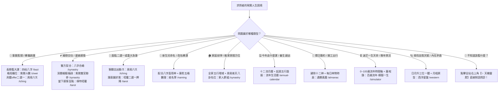

# 🌌 萬象天儀 (Astraea & CelestialDao) — 全系統超詳細使用者說明手冊與問診指南 (USER_MANUAL.md)

> **版本**：v1.0.0-OFFICIAL-MANUAL  
> **發布日期**：2026-10-31  
> **適用平台**：萬象天儀全功能網站（本機預設網址：[http://localhost:5499](http://localhost:5499)）  
> **系統核心**：東西方雙軌星象命理引擎（0% AGPL 授權污染、純 TypeScript 演算）+ 3D WebGL 渾天星盤 + 天機靈犀 AI 明師問診助手

---

## 📖 目錄 (Table of Contents)

1. [系統總覽與命理核心哲學](#1-系統總覽與命理核心哲學)
2. [網站全功能端點與超連結指南 (Website Links Guide)](#2-網站全功能端點與超連結指南-website-links-guide)
3. [算命需求與情境速查矩陣 (一般人找算命老師最常問的 10 大情境)](#3-算命需求與情境速查矩陣-一般人找算命老師最常問的-10-大情境)
4. [12 大核心命理模組超詳細操作教學](#4-12-大核心命理模組超詳細操作教學)
   - 4.1 [紫微斗數排盤與大限行運 (`/ziwei`)](#41-紫微斗數排盤與大限行運-ziwei)
   - 4.2 [四柱八字與十神大運 (`/bazi`)](#42-四柱八字與十神大運-bazi)
   - 4.3 [八字合婚與紫微雙宮聯參合盤 (`/synastry`)](#43-八字合婚與紫微雙宮聯參合盤-synastry)
   - 4.4 [家人群組比對與《周易》後天八卦名位相等 (`/synastry` 群組 Tab)](#44-家人群組比對與周易後天八卦名位相等-synastry-群組-tab)
   - 4.5 [百歲流年·模擬一生系統 (`/simulator`)](#45-百歲流年模擬一生系統-simulator)
   - 4.6 [每日通勝黃曆與吉凶大盤 (`/almanac`)](#46-每日通勝黃曆與吉凶大盤-almanac)
   - 4.7 [流年生活行運曆與起居規劃 (`/annual-calendar`)](#47-流年生活行運曆與起居規劃-annual-calendar)
   - 4.8 [周易六爻金錢卦與梅花易數 (`/iching`)](#48-周易六爻金錢卦與梅花易數-iching)
   - 4.9 [姓名學五格數理與喜用起名 (`/naming`)](#49-姓名學五格數理與喜用起名-naming)
   - 4.10 [西洋本命星盤與八大月相原型 (`/western`)](#410-西洋本命星盤與八大月相原型-western)
   - 4.11 [78 張經典偉特塔羅牌占卜 (`/tarot`)](#411-78-張經典偉特塔羅牌占卜-tarot)
   - 4.12 [七政四餘皇家天星學排盤 (`/qizheng`)](#412-七政四餘皇家天星學排盤-qizheng)
5. [天機靈犀 AI 命理智能問診顧問使用攻略](#5-天機靈犀-ai-命理智能問診顧問使用攻略)
6. [個人命盤雲端保險庫與測算日記 (`/vault`)](#6-個人命盤雲端保險庫與測算日記-vault)
7. [管理員 CMS 後台維運指南 (`/admin`)](#7-管理員-cms-後台維運指南-admin)
8. [常見問題與算命明師心法解惑 (FAQ)](#8-常見問題與算命明師心法解惑-faq)

---

## 1. 系統總覽與命理核心哲學

### 1.1 什麼是萬象天儀？
「萬象天儀 (CelestialDao / Astraea)」是一套現代化頂級星象命理決策系統。不同於傳統命理網站簡陋、廣告充斥、排盤公式簡化錯誤的缺陷，本系統具備：
1. **東西合璧**：東方古典三大支柱（紫微斗數、四柱八字、周易文王六爻、三才五格姓名學、通勝黃曆、七政四餘）與西方神秘學（開普勒本命星盤、八大月相原型、78 張 Waite-Smith 1909 偉特塔羅）。
2. **純粹數學解析**：所有天體坐標均採用自研純 TypeScript 原生 Jean Meeus 天體力學演算法，**0% Swiss Ephemeris (`swisseph`) AGPL 感染風險**，具備經緯度真太陽時與均時差精準校驗。
3. **沉浸式藝術視覺**：搭載 Three.js 3D 渾天儀、3D 塔羅洗牌牌桌、雙主題切換（星淵夜幕 / 晨曦天盤）與 Lenis 精品級平滑滾動。

### 1.2 命理心法哲學：三才之道
本系統始終秉持古典東方正統的「三才配置」核心哲學：
$$\text{人事努力} \left(\frac{1}{3}\right) + \text{地理空間調適} \left(\frac{1}{3}\right) = \frac{2}{3} > \text{先天命格天命} \left(\frac{1}{3}\right)$$
*   **算命是討論「果」的哲學**：知果是為了在事前「修因」轉化；命不可死算，運由心轉。
*   **拒絕江湖恐嚇**：真正的命理師不販賣焦慮，而是幫求測者在迷霧中看清「時機波峰（順境擴大成果）」與「時機波谷（逆境守成蓄力）」，並藉由起居作息、心態調整與空間動線，奪回生命的主導權。

---

## 2. 網站全功能端點與超連結指南 (Website Links Guide)

本站所有前端介面、後台管理與後端 API 均全端整合運行於 **Port 5499** 單一對外端點（Docker 容器單一服務直達）。以下為全站各功能直達網址與適用情境對照表：

| 功能模組名稱 | 站內路徑 (Route) | 完整本地連結 (Port 5499) | 必備輸入條件 | 核心適用情境 |
| :--- | :--- | :--- | :--- | :--- |
| **首頁大堂** | `/` | [http://localhost:5499/](http://localhost:5499/) | 無 | 系統全覽、3D 渾天儀互動、今日黃曆速覽、全功能入口 |
| **使用說明手冊** | `/guide` | [http://localhost:5499/guide](http://localhost:5499/guide) | 無 | 全站功能導覽、算命情境速查地圖、各模組詳細教學 |
| **紫微斗數** | `/ziwei` | [http://localhost:5499/ziwei](http://localhost:5499/ziwei) | 出生年月日時、性別、出生地 | 一生事業財帛格局、命身主星、大限流年小限行運大盤 |
| **四柱八字** | `/bazi` | [http://localhost:5499/bazi](http://localhost:5499/bazi) | 出生年月日時、性別、出生地 | 十神五行生剋、身強身弱、喜用神判定、十年大運走勢 |
| **模擬一生** | `/simulator` | [http://localhost:5499/simulator](http://localhost:5499/simulator) | 本命生辰、女性友人KEYIN | 0~100 歲流年年輪推演、台灣歷史時代風貌、紅顏盲盒、蓋棺錄 |
| **八字合婚與合盤** | `/synastry` | [http://localhost:5499/synastry](http://localhost:5499/synastry) | 雙方性別與生辰年月日時 | 婚戀契合度、天干五合、地支合沖、雙宮聯參、通關五行 |
| **家人群組與名位** | `/synastry` (群組Tab) | [http://localhost:5499/synastry](http://localhost:5499/synastry) | 家庭成員生辰與角色代碼 | 全家五行場域聚合、$C(N,2)$ 關係矩陣、《周易》後天八卦房間配置 |
| **流年生活行運曆** | `/annual-calendar`| [http://localhost:5499/annual-calendar](http://localhost:5499/annual-calendar)| 本命生辰、目標流年、起居數據 | 十二流月曆、月令四化、作息飲食睡眠追蹤、五行諧振評分 |
| **每日通勝黃曆** | `/almanac` | [http://localhost:5499/almanac](http://localhost:5499/almanac) | 查詢西曆日期 | 建除十二神、廿八星宿、九星飛泊、吉凶宜忌、時辰八字吉凶 |
| **周易六爻卜卦** | `/iching` | [http://localhost:5499/iching](http://localhost:5499/iching) | 銅錢搖卦 / 先天數理起卦 | 即時具體事件決策、二選一難題、動爻變卦吉凶、384 爻辭 |
| **姓名學五格起名** | `/naming` | [http://localhost:5499/naming](http://localhost:5499/naming) | 姓氏、當前名字 / 生辰喜用 | 康熙筆劃、天人地總外五格 81 數理、三才生剋、喜用補缺起名 |
| **西洋本命星盤** | `/western` | [http://localhost:5499/western](http://localhost:5499/western) | 出生年月日時、經緯度 | 開普勒十大行星、上升ASC/天頂MC四軸、五大相位、八大月相原型 |
| **偉特塔羅牌占卜** | `/tarot` | [http://localhost:5499/tarot](http://localhost:5499/tarot) | 抽牌張數與牌陣選擇 | 78張完整牌庫、6 大經典牌陣（單張/時間流/聖三角/二選一/六芒星/十字）、程式 Fisher-Yates 隨機洗牌 |
| **七政四餘天星盤** | `/qizheng` | [http://localhost:5499/qizheng](http://localhost:5499/qizheng) | 出生年月日時、經緯度 | 皇家天星學、七政四餘、廿八宿度數入宿、十二辰次、恩難四星 |
| **命盤保險庫與隨筆** | `/vault` | [http://localhost:5499/vault](http://localhost:5499/vault) | 登入會員或 DEMO 身分 | 親友生辰檔案一鍵調用、個人測算感悟日記管理 |
| **後台管理中樞** | `/admin/dashboard`| [http://localhost:5499/admin/dashboard](http://localhost:5499/admin/dashboard)| 管理員登入或 DEMO ADMIN | 運營大盤、SQLite 備份還原、解讀辭庫熱編修、會員權限、LLM 參數 |

---

## 3. 算命需求與情境速查矩陣 (一般人找算命老師最常問的 10 大情境)

當一般人去算命館敲門時，往往是因為現實中碰到了瓶頸或困惑。以下為命理明師臨床問診時最常見的 10 大問題，以及系統中最匹配的解法：

### 10 大問診情境深度解析表

| 情境編號 | 求問者常見的內心真實困惑 | 算命明師的建議視角 | 推薦最佳使用功能模組 | 應準備資料與操作重點 |
| :---: | :--- | :--- | :--- | :--- |
| **情境 1** | **「我想換工作/被挖角，該跳槽還是留下來？」** | 應分兩步看：先看大運流年是否走偏財或官殺（是進取年還是守成年），再針對兩家公司占卜具體吉凶。 | 1. [四柱八字](/bazi) (看喜用神與大運) 2. [紫微斗數](/ziwei) (看官祿宮與化權化祿) 3. [周易六爻](/iching) (占問跳槽結果) | 輸入自身精確出生年月日時；在六爻介面專注默想「去甲公司好還是留原公司好」。 |
| **情境 2** | **「跟現在對象適不適合結婚？未來會不會離婚？」** | 算命切忌只看表面生肖沖剋。合婚首重雙方日主生剋與五行互補，次看紫微夫妻宮與福德宮（雙宮聯參）的包容力。 | [八字合婚與雙宮聯參合盤](/synastry) | 輸入男方與女方的國曆或農曆生日與時辰，查看「五行互補評分」與「夫妻矛盾通關五行」。 |
| **情境 3** | **「家裡氣氛很差，小孩叛逆不聽話，夫妻常冷戰」** | 《易經》名位相等法則指出：「把位置擺對了，人的念頭就正了。」長幼失序常導因於陽宅名位顛倒（如長子住西北乾位）。 | [家人群組與後天八卦名位](/synastry) (切換群組分頁) | 輸入父母、子女的生辰，查看全家五行場域，並對照八卦方位檢視各成員的臥房位置。 |
| **情境 4** | **「剛生寶寶，想取個吉利又能幫襯一生的好名字」** | 正統起名絕非看網路上流行筆畫，必須先精算八字喜用神（缺水補水、缺木補木），再結合康熙正統筆劃與三才五格。 | [姓名學與五格起名推薦](/naming) | 輸入新生兒出生年月日時得出八字喜用神，輸入姓氏，系統自動過濾高分且補足喜用之字。 |
| **情境 5** | **「面臨人生重大二選一（如出國留學 vs 考公職）」** | 當理性分析無法抉擇時，動態爻象或塔羅潛意識投射能直擊局勢本質與最終結果。 | 1. [周易六爻卜卦](/iching) 2. [78 張偉特塔羅二選一牌陣](/tarot) | 心中澄澈安靜，專注想著兩難抉擇，進行金錢卦搖擲或塔羅 5 張二選一抽牌。 |
| **情境 6** | **「今年覺得特別不順、常破財或犯小人，該如何化解？」** | 先看今年流年干支是否與命盤日主相沖（如天剋地沖或歲運並臨），並落實日常起居調神，早睡補水、運動疏肝。 | 1. [流年生活曆與起居規劃](/annual-calendar) 2. [紫微斗數流年大盤](/ziwei) | 查看今年流年命宮星曜與四化星（化祿在何處、化忌在何處），填寫近週作息評估五行諧振。 |
| **情境 7** | **「明天要跟大客戶簽約/開工動土/買車交車，挑什麼時辰好？」** | 應查建除十二神（成日、定日宜簽約，破日、閉日避之），並對照受沖生肖與吉時良辰。 | [每日通勝黃曆](/almanac) | 選擇預計簽約之國曆日期，查看當日宜忌、時辰吉凶（青龍、天德等吉時）與財神喜神方位。 |
| **情境 8** | **「我今年40歲了，對人生下半場感到迷茫，我的天命是什麼？」** | 將八字大運化為 0~100 歲的時間軸，結合歷史時代浪潮，審視自己一生的轉折關口與終局評價。 | [百歲流年·模擬一生](/simulator) | 輸入出生生辰，可自訂 5 位女性友人，系統即刻推演 101 個年輪節點，並生成《一生行誼·蓋棺錄》。 |
| **情境 9** | **「內心感到極大焦慮，不知道自己真正要的是什麼」** | 西洋占星之太陽為英雄之旅，月亮為潛意識安全感，上升為對外人格；塔羅塞爾特十字能剖析心靈冰山下的恐懼。 | 1. [西洋本命星盤與月相](/western) 2. [塞爾特十字塔羅牌陣](/tarot) | 輸入生辰取得上升星座與月相原型；抽 10 張塞爾特十字檢視潛意識核心與未來走向。 |
| **情境 10** | **「我有很多瑣碎問題，不知道該點哪個功能？」** | 不用擔心！本站右上角常駐「✨ 天機靈犀」AI 明師，支援自然語言問診，直接告訴他您的困惑即可！ | [全局右上角 ✨ 天機靈犀抽屜](#5-天機靈犀-ai-命理智能問診顧問使用攻略) | 直接在對話框輸入您的日常白話困惑，AI 明師會像面對面的老算命師一樣為您導航推薦。 |

---

## 4. 12 大核心命理模組超詳細操作教學

### 4.1 紫微斗數排盤與大限行運 (`/ziwei`)
*   **功能路徑**：[http://localhost:5499/ziwei](http://localhost:5499/ziwei)
*   **需要輸入**：
    1. 性別：乾造（男）或 坤造（女）。
    2. 生辰曆法：國曆（西曆）或 農曆（陰曆）。
    3. 年月日時辰：精確到時辰（子、丑、寅、卯、辰、巳、午、未、申、酉、戌、亥）。
    4. 出生地經緯度：預設為台北市 (121.5654, 25.0330)，系統會自動校正真太陽時時差。
*   **畫面重點與解盤指標**：
    *   **本命天盤十二宮**：正中央為命盤核心資訊（五行局、命主、身主、生年四化），外圍十二方格為子丑寅卯辰巳午未申酉戌亥各宮（命宮、兄弟、夫妻、子女、財帛、疾厄、遷移、交友、官祿、田宅、福德、父母）。
    *   **主星與亮度**：紫微、天府、天機、太陽、武曲、天同、廉貞、太陰、貪狼、巨門、天相、天梁、七殺、破軍，並標註「廟、旺、得、利、平、不、陷」亮度。
    *   **行運大盤（大限/流年/小限）**：面板支援輸入目標年份（如 2026），自動推算本命十年大限宮位、流年歲次宮位與小限宮位，並標示流耀四化（`siHua: [祿, 權, 科, 忌]`）。
    *   **正統三合格局識別**：自動辨識君臣慶會、紫府同宮、殺破狼、火貪格、陽梁昌祿等 20+ 種正統格局與破格警示。
    *   **✨ 呼叫天機靈犀**：點擊卡片右上角按鈕，將當前星盤坐標自動注入 AI 展開萬字深度解讀。

---

### 4.2 四柱八字與十神大運 (`/bazi`)
*   **功能路徑**：[http://localhost:5499/bazi](http://localhost:5499/bazi)
*   **需要輸入**：性別、出生年月日時、出生地經緯度。
*   **畫面重點與解盤指標**：
    *   **年月日時四柱**：天干地支八個字，依太陽黃經精準 24 節氣劃分月令。
    *   **地支藏干與十神**：清楚標記日元（元神）與其他干支之十神關係（正印、偏印、正官、七殺、正財、偏財、食神、傷官、比肩、劫財）。
    *   **五行能量儀表板**：木、火、土、金、水能量百分比分布圖，直觀呈現身強、身弱、專旺或從格。
    *   **喜用神診斷**：精確標明命局的「喜神」與「用神」，以及應避忌的「仇神」與「忌神」。
    *   **十年大運時間軸**：橫向推排自起運歲數開始的每步十年大運，點選任一大運即可檢視干支與十神吉凶走勢。

---

### 4.3 八字合婚與紫微雙宮聯參合盤 (`/synastry`)
*   **功能路徑**：[http://localhost:5499/synastry](http://localhost:5499/synastry)
*   **需要輸入**：男方（甲方）生辰與性別、女方（乙方）生辰與性別。
*   **畫面重點與解盤指標**：
    *   **五維契合度評分**：
        1. 天干五合（天賜良緣）：甲己、乙庚、丙辛、丁壬、戊癸合。
        2. 日支夫妻宮合沖（相處默契）：六合、三合、相沖、相刑、相害。
        3. 五行互補指數：一方缺木而另一方木旺，彼此互為喜用貴人。
        4. 年柱根基契合度：納音五行生剋與家世相配。
    *   **通關五行妙方**：若雙方命局相剋（如金木相戰），系統自動推算出「通關五行」（如用水生木化金），並給予穿著、飾品、居住佈局等落地建議。
    *   **紫微雙宮聯參鐵律**：同時比對雙方的「夫妻宮」與「福德宮」（「看婚姻必看福德」），檢驗雙方是否有天作之合（甲夫妻宮主星 = 乙命宮主星）。

---

### 4.4 家人群組比對與《周易》後天八卦名位相等 (`/synastry` 群組 Tab)
*   **功能路徑**：[http://localhost:5499/synastry](http://localhost:5499/synastry)（點擊上方「👨‍👩‍👧‍👦 家人群組比對」Tab）
*   **需要輸入**：新增多位家庭成員（父親、母親、長子、長女、次子、次女、三子、三女），輸入各成員生辰。
*   **畫面重點與解盤指標**：
    *   **全家五行場域聚合**：計算全家人的五行總和，標出家族主導氣場（如崇德向學·青雲得祿）與全家相對匱乏之五行。
    *   **$C(N, 2)$ 兩兩關係互動矩陣**：矩陣化呈現成員兩兩之間的生剋關係與相處建議。
    *   **家庭角色定位賦能**：自動指派家族舵手、心靈調和者、活力開拓者與穩健守護者。
    *   **《周易》後天八卦名位相等空間配置**：
        *   父親居西北乾位、母親居西南坤位（地天泰卦最吉）。
        *   長子居正東震位、長女居東南巽位。
        *   次子居正北坎位、次女居正南離位（水火既濟卦）。
        *   警告長子住西北乾位（雷天大壯，奪父權管教難）等陽宅越位禁忌。

---

### 4.5 百歲流年·模擬一生系統 (`/simulator`)
*   **功能路徑**：[http://localhost:5499/simulator](http://localhost:5499/simulator)
*   **需要輸入**：
    1. 主角姓名、性別、出生年月日時。
    2. （選填）5 位紅顏女性友人自訂生日 KEYIN（沈婉晴、林若曦、宋雨薇、蘇珮儀、趙敏芝），系統會根據西曆年份動態對齊年齡差。
*   **畫面重點與推演特色**：
    *   **0～100 歲時間軸輪盤**：101 個年輪節點，每個節點均有純演算法生成之 100~150 字生命階段年輪說明 (`annualStory`)。
    *   **台灣時代大事紀（1845 清代起至 2060+）**：清代水災時疫、日治鼠疫公醫、戰後幣改、十大建設、加工區、SARS、高鐵、矽盾科技與 AI 浪潮。
    *   **各時代平均壽命與傳染病機制**：清代 40 歲進入衰退期，現代至 75 歲以上才老衰；疫病年份亮起警報並自適應生成防疫選項。
    *   **四大領域數值 HUD**：體魄健康 (`health`)、知識才識 (`knowledge`)、財富資產 (`wealth`)、情感眷屬 (`relationship`) 動態演進。
    *   **男性視角紅顏盲盒相遇**：18, 22, 26, 30, 34 歲觸發盲盒邂逅，不暴雷姓名，全憑心境做出抉擇，動態追蹤相手好感度 (`herAffinity`)。
    *   **日式寫實風格插畫全景渲染**：14 幅高品質插畫（9 大人生階段年輪卡牌 + 5 位紅顏立繪）。
    *   **轉折年與大凶大吉年命理錦囊**：大凶年亮起玫瑰紅警報、大吉年亮起琥珀金順風，選項動態掛載 `[✓ 避煞首選]`、`[⭐ 轉折關鍵]`。
    *   **終局《一生行誼·蓋棺錄》與 80 億分之一的遊戲**：壽元耗盡或滿百歲時秒開彈窗，支援三大自傳視角（🔮 三合天機心法、📜 正史太史公列傳、☕ 現代時代回憶錄）與【🌌 80 億分之一的遊戲】真身大揭曉。

---

### 4.6 每日通勝黃曆與吉凶大盤 (`/almanac`)
*   **功能路徑**：[http://localhost:5499/almanac](http://localhost:5499/almanac)
*   **需要輸入**：預設為今日，可選擇任一國曆日期。
*   **畫面重點與解盤指標**：
    *   **農曆歲次與建除十二神**：建、除、滿、平、定、執、破、危、成、收、開、閉值日吉凶。
    *   **二十八星宿禽星值日**：角木蛟、亢金龍至軫水蚓歌訣與九星飛泊。
    *   **精選宜忌標籤**：祭祀、嫁娶、開市、動土、簽約、出行、安葬等精準指引。
    *   **神煞方位與相沖生肖**：喜神、福神、財神方位，三煞方與當日相沖生肖。
    *   **十二時辰吉凶輪盤**：子丑寅卯各時辰之黃黑道（青龍、明堂、金匱吉時 vs 天刑、朱雀凶時）。

---

### 4.7 流年生活行運曆與起居規劃 (`/annual-calendar`)
*   **功能路徑**：[http://localhost:5499/annual-calendar](http://localhost:5499/annual-calendar)
*   **需要輸入**：本命生辰年月日時、目標流年年份（預設當前年份）。
*   **畫面重點與解盤指標**：
    *   **五虎遁起月十二流月曆**：目標流年歲綱、日主十神、紫微流年命宮星曜與純星名四化，以及 12 個流月的干支月十神。
    *   **每日生活起居習慣日記**：登錄作息睡眠時間、五味飲食偏好、飲水量、運動分鐘與精力狀態。
    *   **命盤五行諧振評分 (0~100 分)**：將起居數據與本命喜用五行交叉對比，產出木火土金水滋養度雷達。
    *   **天機靈犀 AI 年度生活規劃書**：調用專屬生活規劃顧問，產出四時養生、避凶月令與商務出擊指南。

---

### 4.8 周易六爻金錢卦與梅花易數 (`/iching`)
*   **功能路徑**：[http://localhost:5499/iching](http://localhost:5499/iching)
*   **需要輸入**：心中默想的特定問題，可選「🪙 3 枚銅錢六爻搖卦（六擲成卦）」或「🌸 梅花易數數理起卦」。
*   **畫面重點與解盤指標**：
    *   **六爻推演過程**：精確模擬老陽(9)、少陽(7)、少陰(8)、老陰(6) 機率。
    *   **五重卦象矩陣**：本卦（當前局勢）、之卦/變卦（動爻轉換後的未來結果）、互卦（事態中間過程）、錯卦（反面觀點）、綜卦（對手視角）。
    *   **384 爻辭與世應定位**：清楚標記世爻（自己）、應爻（對方/目標）與動爻爻辭詳解。

---

### 4.9 姓名學五格數理與喜用起名 (`/naming`)
*   **功能路徑**：[http://localhost:5499/naming](http://localhost:5499/naming)
*   **需要輸入**：現有姓名評測（輸入姓氏與名字）或 新生兒喜用起名推薦（輸入八字生辰與姓氏）。
*   **畫面重點與解盤指標**：
    *   **康熙正統筆劃**：自動按傳統部首（水部算四劃、草頭算六劃等）精準換算。
    *   **天人地總外五格 81 數理**：天格、人格、地格、總格、外格吉凶分析與五格總分。
    *   **三才配置五行格局**：從 125 種三才生剋組合判定基礎運與成功運。
    *   **八字喜用智能補缺起名**：根據命中欠缺之五行（如缺水木），推薦兼具高分數理與五行平衡的佳名庫。

---

### 4.10 西洋本命星盤與八大月相原型 (`/western`)
*   **功能路徑**：[http://localhost:5499/western](http://localhost:5499/western)
*   **需要輸入**：出生年月日時、出生城市經緯度。
*   **畫面重點與解盤指標**：
    *   **開普勒天體十大行星度數**：太陽、月亮、水星、金星、火星、木星、土星、天王星、海王星、冥王星。
    *   **四軸與十二宮位**：上升點 (ASC)、天頂 (MC)、下降點 (DSC)、天底 (IC) 與 Placidus 宮位劃分。
    *   **五大主要相位網格**：合相 (0°)、六分相 (60°)、四分相 (90°)、三分相 (120°)、對分相 (180°)。
    *   **八大月相靈魂原型**：日月黃經夾角映射至新月、眉月、上弦月、盈凸月、滿月、虧凸月、下弦月、殘月。

---

### 4.11 78 張經典偉特塔羅牌占卜 (`/tarot`)
*   **功能路徑**：[http://localhost:5499/tarot](http://localhost:5499/tarot)
*   **需要輸入**：選擇牌陣，心中默想問題，點擊洗牌與抽牌。
*   **畫面重點與解盤指標**：
    *   **⚠️【抽牌確定性鐵律】**：本系統完整內建 78 張獨立韋特塔羅牌義，**抽牌嚴格由程式 Fisher-Yates 隨機洗牌演算法客觀抽出（不由 AI 進行）**，AI 僅負責依據已抽出的牌面進行深度潛意識解讀與決策啟迪。
    *   **6 種經典牌陣**：
        1. 每日神諭單張牌陣 (Daily Oracle，1 張)
        2. 時間之流牌陣 (過去 / 現在 / 未來，3 張)
        3. 身心靈聖三角牌陣 (Mind, Body, Spirit，3 張)
        4. 二選一抉擇牌陣 (兩條路徑比較，5 張)
        5. 六芒星全方位吉凶牌陣 (因果阻力與終局預測，7 張)
        6. 經典塞爾特十字牌陣 (深度全方位解碼，10 張)
    *   **78 張獨立深度正逆位牌義**：採用 Pamela Colman Smith 1909 公有領域高解析度牌面，56 張小阿爾克那與 22 張大阿爾克那均具備獨立的正逆位關鍵詞、心靈概論、愛情指引與事業決策方針。

---

### 4.12 七政四餘皇家天星學排盤 (`/qizheng`)
*   **功能路徑**：[http://localhost:5499/qizheng](http://localhost:5499/qizheng)
*   **需要輸入**：出生年月日時、經緯度。
*   **畫面重點與解盤指標**：
    *   **七政與四餘隱曜**：日月五星（日、月、水、金、火、木、土）與四餘（羅睺、計都、月孛、紫炁）。
    *   **二十八星宿度數入宿**：角亢氐房心尾箕、斗牛女虛危室壁、奎婁胃昴畢觜參、井鬼柳星張翼軫度數精確排布。
    *   **十二辰次與人事十二宮**：星紀、玄枵至析木十二次，以及恩星、難星、仇星、用星吉凶格局。

---

## 5. 天機靈犀 AI 命理智能問診顧問使用攻略

### 5.1 隨時點擊右上角「✨ 天機靈犀」
在全站任何頁面，頂部導航列右上角皆常駐「✨ 天機靈犀」按鈕，點擊即可從右側滑出專屬琉璃光暈對話抽屜。

### 5.2 自動星盤上下文注入 (Context Grounding)
當您在任一排盤頁面（例如紫微斗數或八字）點擊「✨ 呼叫天機靈犀」時，抽屜頂部會亮起【✨ 引用星盤: 紫微斗數 (當前盤面)】徽章，AI 會將您的命宮主星、四化星、五行喜用全數帶入背景，無需重複手打生辰！

### 5.3 智能問診與情境導航功能 (Agent Navigator)
如果您還沒有排盤，或不知道自己的問題適合哪一個功能，可以直接詢問靈犀！
*   **您可以這樣問**：
    *   *「老師，我最近工作好累，不知道該跳槽還是留著忍耐，請推薦我該看哪個功能？」*
    *   *「老師，我跟另一半常吵架，不知道兩個人到底合不合，可以幫我算嗎？」*
    *   *「我想幫下個月出生的寶寶取名字，該怎麼做？」*
    *   *「我現在手上有兩個 offer，該怎麼抉擇？」*
*   **AI 靈犀明師的回覆特色**：
    1. **安定心神**：以數十年算命老師的慈悲溫暖語調，理清事情的本質。
    2. **給出直達連結**：回覆中直接附帶點擊可開啟的站內連結（如 `[👉 前往四柱八字](/bazi)`）。
    3. **提醒準備資料**：告訴您需要準備哪些生辰、心中默想什麼問題。
    4. **賦能心法**：提醒您「人事大於天命」，主動掌握命運。

---

## 6. 個人命盤雲端保險庫與測算日記 (`/vault`)

*   **功能路徑**：[http://localhost:5499/vault](http://localhost:5499/vault)
*   **核心功能**：
    1. **親友命盤保險庫**：儲存自己、伴侶、父母、子女的生辰檔案，日後排盤時一鍵載入，免重複輸入。
    2. **測算感悟日記**：記錄每次占卜的卦象、塔羅牌陣與後續驗證心得，見證人生智慧的積累。

---

## 7. 管理員 CMS 後台維運指南 (`/admin`)

*   **後台首頁**：[http://localhost:5499/admin/dashboard](http://localhost:5499/admin/dashboard)
*   **進入方式**：
    *   點擊頂部導航列「⚙️ 後台管理中樞」按鈕。
    *   或直接點擊右上角會員頭像進入。
*   **後台核心功能**：
    1. **運營統計大盤 (`/admin/dashboard`)**：即時呈現各排盤模組調用熱力圖與會員統計。
    2. **命理辭庫管理 (`/admin/interpretations`)**：在線即時搜尋與編修資料庫辭條，支援 JSON 匯出與批次 Upsert 匯入。
    3. **會員權限管理 (`/admin/users`)**：管理會員等級（MEMBER、VIP、ADMIN）與重設密碼。
    4. **資料庫管理與備份 (`/admin/database`)**：即時快照備份 SQLite (`.db`)、下載備份檔、一鍵安全還原、表格原始資料檢視（已排除機敏 Hash）。
    5. **大語言模型設定 (`/admin/llm-settings`)**：在線動態切換本地大模型（Ollama/vLLM）或外部 OpenAI 相容 API（GPT-4o、Claude、DeepSeek），具備完整 SSRF 內網安全防護。

---

## 8. 常見問題與算命明師心法解惑 (FAQ)

### Q1：不知道自己出生在幾點幾分怎麼辦？
*   **明師解答**：
    1. 若記得時辰區間（如中午、黃昏），可選對應時辰（如午時 11:00~13:00、酉時 17:00~19:00）。
    2. 若完全不知時辰，可先看日柱天干（四柱八字）了解自身基本五行個性，或使用無時辰依賴的周易文王六爻、韋特塔羅進行即時決策。

### Q2：排盤算出來是大凶，是不是人生就毀了？
*   **明師解答**：
    *   **絕非如此！** 命理學中的「凶」往往代表「變革、摩擦與修煉」。例如紫微斗數的化忌代表「執念與功課」，八字七殺代表「自律與高壓挑戰」。大凶年只要採取「避凶守成、修德行善、不盲目擴張投資」的策略，往往能轉化為人生成長最關鍵的基石。

### Q3：為什麼要校正真太陽時？
*   **明師解答**：
    *   地球自轉與公轉軌道為橢圓形，且每個城市的經度不同（如台北經度約 121.56°，比標準時區 120° 提前約 6 分鐘）。本系統自動以天文幾何方程計算均時差與經度差，確保跨時辰交界點排盤毫釐不差。

### Q4：萬象天儀會把我的個資賣給第三方嗎？
*   **明師解答**：
    *   **絕不會。** 本系統嚴格遵守台灣《個人資料保護法》，生辰與姓名僅用於本地演算法排盤；所有資料在庫均受權限保護，生產環境下預設關閉 Demo 權限，保障隱私絕對安全。

---
*萬象天儀 — 願星辰指引你的方向，願智慧點亮你的前路。*
