# 萬象天儀 (Astraea & CelestialDao) — 全系統使用性、流暢性與功能故事性深度診斷改善報告

> **診斷範圍**：前端 16 個核心視圖 (`apps/web/src/views/*`)、導航與 AI 互動組件 (`Navbar.vue`, `InPageAiAnalysis.vue`, `LlmAssistantModal.vue`, `ArmillarySphere.vue`)、狀態管理 (`stores/llm.ts`, `stores/auth.ts`)、核心數理與占卜引擎 (`packages/astro-core/*`)、後端 AI 導覽服務 (`apps/server/src/modules/llm/service.ts`) 及雙端使用手冊 (`USER_MANUAL.md`, `UserManualView.vue`)。  
> **落地狀態**：**✅ 全數改善完成 (Phase 1, 2, 3 全面落地並完成編譯與自動化意圖測試驗證)**。

---

## 一、 診斷總覽與四維健康度評分 (Executive Summary)

「萬象天儀」已具備極為罕見的**東西方命理廣度**（15 大子系統橫跨紫微、八字、七政四餘、西洋星盤、易經、塔羅、文鳥、廟宇籤詩、周公解夢、合婚、流年曆、百歲模擬等）與一致的**暗黑鎏金宇宙視覺美學 (Dark Cosmic Aesthetics)**。所有核心排盤與抽籤隨機邏輯皆已收歸 `@celestial/astro-core` 確定性運算，架構基底紮實。

然而，隨著模組從 6 個快速擴張至 15 個，系統目前呈現**「單點功能豐富、跨頁連動斷裂、儀式節奏僵硬、部分新舊介面契約脫鉤」**的成長痛點。

| 診斷維度 | 現況評分 (滿分 10) | 核心優勢 | 關鍵短板摘要 |
| :--- | :---: | :--- | :--- |
| **0. 執行期穩定度與資料正確性 (Stability & Accuracy)** | **5.8 / 10** | 核心排盤演算法 (`astro-core`) 具確定性、無 AI 幻覺排盤 | 3 個新占卜頁點擊 AI 解讀直接拋出 `TypeError`；農民曆十天干全被寫死為「`X木日主`」；解夢未命中關鍵字時強制回傳「夢見蛇與龍（大吉）」；3 個視圖因屬性名稱錯置導致 AI 提示詞遺失卦名/分數/月相；`/annual-calendar` 路由死鏈。 |
| **1. 使用性與資訊架構 (Usability & IA)** | **6.5 / 10** | 雙排導覽列結構清晰、各頁視覺階層一致、手冊情境問診設計貼心 | 「命盤檔案庫 (`VaultView`)」與各排盤頁完全斷連（點擊排盤不帶入生辰、5 大命盤頁無載入按鈕、`LifeSimulatorView` 讀取不存在的 `localStorage` 鍵）；16 個導覽項目水平溢出且管理後台入口重複出現 4 次；首頁 3D 渾天儀在手機端阻斷垂直滑動 (`touch-none`)。 |
| **2. 流暢性與效能節奏 (Fluency & Performance)** | **6.2 / 10** | 本地端排盤毫秒級響應、過渡動畫豐富 | 16 個頁面全數靜態引入，單一 JS Bundle 高達 `1,534 KB`；靜態圖片未壓縮（單張 `860 KB ~ 1.3 MB`）且文鳥叼籤圖在動畫中途才掛載造成閃白；文鳥 `5.4 秒` 強制等待無略過鈕；塔羅牌進頁自動抽牌且直接翻開（牌背點擊邏輯淪為死碼）；頁內 AI 轉開啟右側抽屜時會重複發送 API 重新生成。 |
| **3. 功能故事性與內容深度 (Storytelling & Journey)** | **6.8 / 10** | 百歲模擬器紅藍顏盲盒、流年曆結合內經養生、AI 命理師導覽極具沉浸感 | 15 個模組各自成為「算完即走的孤島」，缺乏「立命 → 歲運 → 占卜 → 調神 → 覆盤」閉環引導；易經與塔羅缺少「所問何事」輸入框；解夢「花草樹木 (`plant`)」分類為 **0 筆詞條**；說明手冊多處宣稱功能（媽祖/關公神明選擇、千條夢典、紫微農曆切換）與實際程式碼不符。 |

---

## 二、 第一部分：P0 嚴重阻斷與執行期錯誤 (Critical Bugs & Broken Flows)

以下 **7 項 P0 問題**屬於功能損壞、執行期崩潰或嚴重誤導使用者的資料錯誤，建議列為第一優先修復項目：

### P0-1. 文鳥、廟宇籤詩、周公解夢點擊「AI 大師解讀」直接拋出 `TypeError` 崩潰
* **問題定位**：
  * [`apps/web/src/views/BunchoView.vue`](file:///home/coder/Codebase/Horoscope/apps/web/src/views/BunchoView.vue#L448) (`askAiInterpretation`)
  * [`apps/web/src/views/TemplePoemView.vue`](file:///home/coder/Codebase/Horoscope/apps/web/src/views/TemplePoemView.vue#L493) (`askAiInterpretation`)
  * [`apps/web/src/views/DreamView.vue`](file:///home/coder/Codebase/Horoscope/apps/web/src/views/DreamView.vue#L391-L424) (`askAiForSymbol` 與 `askAiForScenario`)
  * [`apps/web/src/stores/llm.ts`](file:///home/coder/Codebase/Horoscope/apps/web/src/stores/llm.ts#L50-L59)
* **診斷細節**：
  上述三個新視圖在點擊「請 AI 大師深度解籤 / 解夢」按鈕時，皆呼叫了 `llmStore.openAssistantWithContext({ title, moduleType, summary, rawData, initialPrompt })`。然而 `useLlmStore` 僅定義並匯出了 `openAssistant(context?: ChartContext, initialPrompt?: string)`，根本不存在 `openAssistantWithContext` 方法（且因 `apps/web` 的 `pnpm build` 僅執行 `vite build` 而未執行 `vue-tsc` 型別檢查，故打包時未報錯）。使用者一旦點擊該按鈕，瀏覽器立即拋出 `Uncaught TypeError: llmStore.openAssistantWithContext is not a function`，按鈕完全無反應。
* **修復方案**：
  在 [`apps/web/src/stores/llm.ts`](file:///home/coder/Codebase/Horoscope/apps/web/src/stores/llm.ts#L19-L26) 擴充 `ChartContext` 的 `moduleType` 聯合型別（加入 `'BUNCHO' | 'TEMPLE_POEM' | 'DREAM' | 'QIZHENG' | 'ALMANAC' | 'SYNASTRY' | 'ANNUAL_PLANNER' | 'LIFE_SIMULATOR'`），並新增相容方法 `openAssistantWithContext(payload)` 轉發至 `openAssistant(context, payload.initialPrompt)`。

### P0-2. 農民曆十天干日主宜忌全部被寫死為「`{{ stem }}木日主`」
* **問題定位**：[`apps/web/src/views/AlmanacView.vue`](file:///home/coder/Codebase/Horoscope/apps/web/src/views/AlmanacView.vue#L292)
* **診斷細節**：
  第 292 行在迴圈 `v-for="(info, stem) in almanac.dayMasterGuidance"` 中，將標題寫死為：
  ```html
  <span class="font-bold text-dark-gold">{{ stem }}木日主</span>
  ```
  導致畫面上同時出現 **「甲木日主、乙木日主、丙木日主、丁木日主、戊木日主、己木日主、庚木日主、辛木日主、壬木日主、癸木日主」** 的荒謬命理錯誤（火、土、金、水八個天干全成了木日主）。
* **修復方案**：
  建立天干五行對照表 `STEM_ELEMENT_MAP = { 甲: '木', 乙: '木', 丙: '火', 丁: '火', 戊: '土', 己: '土', 庚: '金', 辛: '金', 壬: '水', 癸: '水' }`，渲染為 `{{ stem }}{{ STEM_ELEMENT_MAP[stem] }}日主`。

### P0-3. 周公解夢：`🌿 花草樹木` 分類為 0 筆空殼，且自由描述未命中時強制回傳「夢見蛇與龍（大吉）」
* **問題定位**：
  * [`packages/astro-core/src/dream/dictionary.ts`](file:///home/coder/Codebase/Horoscope/packages/astro-core/src/dream/dictionary.ts#L12)
  * [`packages/astro-core/src/dream/calculator.ts`](file:///home/coder/Codebase/Horoscope/packages/astro-core/src/dream/calculator.ts#L117-L118)
* **診斷細節**：
  1. `DREAM_CATEGORIES` 定義了 8 個分類，其中 `{ key: 'plant', name: '花草樹木', icon: '🌿', description: '花果、松柏、竹林、稻穀、落葉' }` 在 `DREAM_DICTIONARY`（全庫僅 29 筆）中**連 1 筆 `category: 'plant'` 的資料都沒有**。使用者在 [`DreamView.vue`](file:///home/coder/Codebase/Horoscope/apps/web/src/views/DreamView.vue#L97-L110) 點擊「🌿 花草樹木」必顯示「查無此意象詞條」。
  2. 在 `interpretDreamScenario()`（[`calculator.ts:117-118`](file:///home/coder/Codebase/Horoscope/packages/astro-core/src/dream/calculator.ts#L117-L118)）中，當使用者輸入的夢境描述未命中任何詞條關鍵字時（例如輸入「夢見上班遲到找不到手機」或「夢見在森林採桃花」），程式直接執行：
     ```ts
     const finalSymbols = matchedSymbols.length > 0
       ? matchedSymbols.slice(0, 4)
       : [DREAM_DICTIONARY[0], DREAM_DICTIONARY[1]]; // 蛇、龍！
     ```
     導致無論使用者夢見什麼日常情境，只要不在 29 個詞條內，系統都會煞有其事地告訴使用者：**「核心意象為【蛇】與【龍】，主大吉、名利雙收」**，嚴重破壞信任感。
* **修復方案**：
  1. 於 `DREAM_DICTIONARY` 補齊 `plant` 分類核心詞條（桃花、松柏、竹林、果實熟落、禾稼豐收、枯木逢春等）與常見現代生活夢境詞條（遲到、迷路、掉手機、踩空等）。
  2. 當 `matchedSymbols.length === 0` 時，不再硬塞 `DREAM_DICTIONARY[0..1]`（蛇與龍），改為回傳「依夢境情緒（`mood`）與五臟神魂推演之通用解讀」，並提示使用者可啟動 AI 針對自訂情節深入剖析。

### P0-4. 路由死鏈 `/annual-calendar` 與缺少 404 兜底路由 (空白畫面陷阱)
* **問題定位**：
  * [`apps/web/src/router/index.ts`](file:///home/coder/Codebase/Horoscope/apps/web/src/router/index.ts#L26-L31)
  * [`apps/web/src/views/UserManualView.vue`](file:///home/coder/Codebase/Horoscope/apps/web/src/views/UserManualView.vue#L592-L875) (第 592, 614, 796 行)
  * [`USER_MANUAL.md`](file:///home/coder/Codebase/Horoscope/USER_MANUAL.md#L22-L114) (第 22, 67, 99, 114 行)
  * [`apps/server/src/modules/llm/service.ts`](file:///home/coder/Codebase/Horoscope/apps/server/src/modules/llm/service.ts#L412-L1504) (第 412, 1429, 1504 行)
* **診斷細節**：
  `router/index.ts` 僅註冊了 `/annual-planner`（別名 `/planner`），但網站內建手冊頁 (`UserManualView.vue`)、Markdown 手冊 (`USER_MANUAL.md`) 以及後端 AI 導覽員回覆連結全部指向 `/annual-calendar`。更嚴重的是，`router/index.ts` 沒有配置 `/:pathMatch(.*)*` 404 路由，因此使用者點擊手冊或 AI 推薦的 `/annual-calendar` 連結時，會進入**完全空白的 `<main>` 畫面**且無任何錯誤提示。此外，`router/index.ts` 第 26-29 行同時對 `/temple` 與 `/zhougong` 定義了 `alias` 與 `redirect` 路由，造成重複路由宣告。
* **修復方案**：
  在 `/annual-planner` 路由加上 `alias: ['/planner', '/annual-calendar']`，移除重複的 `/temple` 與 `/zhougong` redirect 物件，並新增 `/:pathMatch(.*)*` 導向友善的星象迷途引導頁或首頁。

### P0-5. 易經、姓名學、西洋星盤因欄位名稱錯置，導致傳給 AI 的上下文缺漏或錯誤
* **問題定位**：
  * **易經六爻 (`IchingView.vue`)**：
    * [`apps/web/src/views/IchingView.vue`](file:///home/coder/Codebase/Horoscope/apps/web/src/views/IchingView.vue#L215) 讀取 `divinationResult.value?.originalHexagram?.name`，但 `@celestial/astro-core` 回傳的屬性名稱是 `baseHexagram`（見第 132 行 `divinationResult.baseHexagram.name`）。這導致 `originalHexagramName` 永遠是空字串 `""`，傳給 AI 的 Prompt 變成 `「本卦得【】，之卦（變卦）為【...】」`！
    * 同檔第 83 行 `<span class="text-dark-muted font-serif">第 {{ 6 - idx }} 爻</span>` 在迭代 `reversedYaos`（已是 `tossedYaos.slice().reverse()`）時，當使用者擲出**第一枚**銅錢（初爻，`tossedYaos.length === 1`，`idx = 0`）時，畫面上竟標示為 **「第 6 爻」**（應為 `第 {{ tossedYaos.length - idx }} 爻`）。
  * **姓名學 (`NamingView.vue`)**：
    * [`apps/web/src/views/NamingView.vue`](file:///home/coder/Codebase/Horoscope/apps/web/src/views/NamingView.vue#L234-L235) 讀取 `analysisResult.value?.fiveGrids?.totalScore` 與 `threeTalents?.fortune`，但實際欄位名稱為 `overallScore`（見第 74 行）與 `level`（見第 91 行）。導致頁內 AI 摘要與 Prompt 永遠顯示 **「五格總評分: 0分 · 三才配置: ()」**！
  * **西洋星盤 (`WesternView.vue`)**：
    * [`apps/web/src/views/WesternView.vue`](file:///home/coder/Codebase/Horoscope/apps/web/src/views/WesternView.vue#L273) 讀取 `chart.value?.lunarPhase?.phaseName`，但實際欄位為 `chart.value?.lunarPhase?.name`（見第 147 行）。導致無論何時排盤，傳給 AI 的月相永遠 fallback 為 **`'滿月'`**！

### P0-6. 頁內 AI 診斷組件 (`InPageAiAnalysis.vue`) 重新排盤後不會清空舊報告（張冠李戴風險）
* **問題定位**：[`apps/web/src/components/ai/InPageAiAnalysis.vue`](file:///home/coder/Codebase/Horoscope/apps/web/src/components/ai/InPageAiAnalysis.vue#L174-L231)
* **診斷細節**：
  `InPageAiAnalysis.vue` 未監聽 (`watch`) `props.prompt` 或 `props.summary`。當使用者先替「A 命主」排盤並點擊生成 AI 報告後，接著在頂部修改生辰為「B 命主」重新排盤時，上方盤面已更新為 B，但下方的 `InPageAiAnalysis` 卻**繼續顯示 A 命主的舊 AI 批註報告**，造成嚴重的命盤與解讀張冠李戴。
* **修復方案**：
  在 `InPageAiAnalysis.vue` 中加入 `watch(() => [props.summary, props.prompt], () => { reply.value = ''; errorMsg.value = ''; })`，當上游盤面數據變更時自動重置舊報告狀態。

### P0-7. 百歲模擬器 (`LifeSimulatorView.vue`) 的「載入已存命盤」永遠無法顯示
* **問題定位**：[`apps/web/src/views/LifeSimulatorView.vue`](file:///home/coder/Codebase/Horoscope/apps/web/src/views/LifeSimulatorView.vue#L1151-L1160)
* **診斷細節**：
  `VaultView.vue`、`SynastryView.vue` 與 `AnnualPlannerView.vue` 都是透過後端 API `GET /api/v1/profiles` 存取命盤檔案；唯獨 `LifeSimulatorView.vue` 的 `loadVaultProfiles()` 去讀取 `localStorage.getItem('celestial_vault_profiles')`（全系統沒有任何地方寫入此 key）。結果 `savedProfiles` 永遠為空陣列 `[]`，第 23 行 `v-if="savedProfiles.length > 0"` 的「載入命盤」下拉選單永遠不會出現。

---

## 三、 第二部分：使用性診斷 (Usability, Information Architecture & Ergonomics)

### 2.1 命盤檔案庫 (`VaultView`) 與 8 大命理視圖的「資料孤島」斷裂
對於一個擁有 8 個生辰排盤模組（紫微、八字、西洋、七政、姓名、合婚、流年曆、百歲模擬）的系統，**「輸入一次生辰，全站無縫切換排盤」**是最核心的使用性基礎。目前此流程在三個環節斷裂：
1. **從 `VaultView` 點擊排盤不帶任何參數**：
   在 [`apps/web/src/views/VaultView.vue`](file:///home/coder/Codebase/Horoscope/apps/web/src/views/VaultView.vue#L96-L113) 中，每張人物卡片下方的「排紫微盤」、「排八字盤」、「排西洋星盤」按鈕只是靜態的 `<router-link to="/ziwei">`，完全沒有傳遞 `profileId` 或生辰參數。使用者點過去後，看到的依然是寫死的預設日期（`1995-10-24` 或 `2000-01-01`），必須手動重新輸入一次。
2. **5 大核心排盤頁缺少「快速載入已存命盤」下拉選單**：
   [`UserManualView.vue`](file:///home/coder/Codebase/Horoscope/apps/web/src/views/UserManualView.vue#L959) 明文宣稱：「在任何排盤介面，點擊『快速載入』，即可一秒填妥所有欄位。」但實際上，`ZiweiView`、`BaziView`、`WesternView`、`QizhengView`、`NamingView` 五個主力頁面**完全沒有載入命盤的 UI**。
3. **全域缺少 `activeProfile` 共享狀態**：
   使用者在 `BaziView` 輸入完自己的生日與經緯度後，切到隔壁的 `ZiweiView` 或 `QizhengView` 想對照看盤時，表單又跳回預設的 `1995-10-24`，必須重複輸入。
* **改善建議**：
  建立輕量的 Pinia `useProfileStore`（整合 `/api/v1/profiles` 與當前 `activeProfile` session 快取），並抽出共用組件 `<BirthInputBar>`，讓所有需要生辰的頁面自動同步當前選定的命主資料，且支援從 `VaultView` 帶 `?profileId=xxx` 直接一鍵開盤。

### 2.2 生辰與地理輸入表單規格不一、操作門檻偏高
* **經緯度需手動輸入小數點**：
  `BaziView`、`ZiweiView`、`WesternView`、`QizhengView`、`VaultView` 均要求使用者手動輸入 `經度 (如 121.56)` 與 `緯度 (如 25.03)`。一般問命民眾並不知道自己出生城市的經緯度數值。應提供**「常用城市快速選單（台北、新北、台中、台南、高雄、香港、新加坡、東京、紐約、倫敦等 + 自動帶入經緯度）」**，保留數值微調給進階玩家。
* **時區標示誤導 (`WesternView.vue`)**：
  [`WesternView.vue`](file:///home/coder/Codebase/Horoscope/apps/web/src/views/WesternView.vue#L15) 欄位標籤寫著 `出生日期與時間 (UTC)`，但第 281 行 `new Date(birthDateTime.value)` 實際上是以瀏覽器本地時區 (Local Time) 解析，標籤寫 `(UTC)` 會害台灣使用者自己減 8 小時，導致上升星座與宮位全錯。
* **紫微斗數缺少「農曆/國曆切換」與「流年年份選擇」**：
  `BaziView` 有提供國曆/農曆切換，但更常被長輩以農曆生辰詢問的 [`ZiweiView.vue`](file:///home/coder/Codebase/Horoscope/apps/web/src/views/ZiweiView.vue#L15-L50) 卻只有國曆 `datetime-local` 輸入框，且缺少 `targetYear`（流年四化年份）選擇器。
* **八字起名推薦 (`NamingView.vue`) 缺少生辰換算喜用神**：
  [`NamingView.vue`](file:///home/coder/Codebase/Horoscope/apps/web/src/views/NamingView.vue#L163-L174) 的「功能二：八字喜用神智慧起名推薦」並無生辰輸入框，而是要求父母自己勾選「喜木 / 喜火 / 喜土 / 喜金 / 喜水」。多數父母在不知道寶寶八字喜用神的情況下無法使用，應允許直接由生辰自動推算喜用五行並預選。

### 2.3 導覽列 (`Navbar.vue`) 資訊過載與「後台管理」過度曝光
* **問題定位**：[`apps/web/src/components/layout/Navbar.vue`](file:///home/coder/Codebase/Horoscope/apps/web/src/components/layout/Navbar.vue#L60-L189)、[`apps/web/src/App.vue`](file:///home/coder/Codebase/Horoscope/apps/web/src/App.vue#L49)
* **診斷細節**：
  1. **第二排導覽列塞入 17 個平鋪連結**：在 `Navbar.vue` 第 170-187 行，16 個功能頁面加上 `⚙️ 系統後台配置` 排成單行水平捲動（且設了 `.no-scrollbar` 隱藏捲軸，亦無左右漸層遮罩或箭頭提示）。在筆電與手機螢幕上，排在後半段的「合婚、流年曆、百歲模擬、文鳥、廟宇籤詩、解夢、命盤庫」很容易被誤以為不存在。
  2. **管理後台與 DEMO 按鈕在一般消費者畫面重複出現 4 次**：
     * Navbar 第一排中央：`⚙️ 後台管理中樞 CMS`（紫底高亮按鈕）
     * Navbar 第一排右側：`👑 DEMO模式 ADMIN` 切換鈕
     * Navbar 第一排頭像文字：`點擊進入後台 ⚙️`
     * Navbar 第二排尾端：`⚙️ 系統後台配置`
     * Footer 頁尾：`⚙️ 後台管理`
     這會讓一般求測者產生「我正在使用工程師測試版後台」的出戲感。
* **改善建議**：
  * 將第二排 16 個模組依使用情境收斂為 **4 大下拉分組或膠囊分組**：
    1. **【先天命盤】**（紫微、八字、西洋、七政、姓名）
    2. **【靈機占卜】**（易經、塔羅、文鳥、廟宇籤詩、周公解夢）
    3. **【歲運與關係】**（每日農民曆、流年行運曆、八字合婚、百歲模擬）
    4. **【個人中樞】**（命盤檔案庫、使用手冊）
  * 將 CMS 後台入口與 DEMO 權限切換收合至右上角使用者頭像點擊後的 Popover 選單內。

### 2.4 手機端觸控與閱讀人體工學問題
1. **首頁 3D 渾天儀觸控滑動陷阱 (`ArmillarySphere.vue`)**：
   [`apps/web/src/components/celestial/ArmillarySphere.vue`](file:///home/coder/Codebase/Horoscope/apps/web/src/components/celestial/ArmillarySphere.vue#L2) 在外層容器設定了 `touch-none` (`touch-action: none`)，而在 [`HomeView.vue`](file:///home/coder/Codebase/Horoscope/apps/web/src/views/HomeView.vue#L73) 中該組件佔據了手機首屏中央 `340px` 高度。當手機使用者手指落在渾天儀區域想往下滑動瀏覽 15 大模組卡片時，畫面會被 3D 旋轉攔截而無法向下捲動頁面。建議在手機端改為 `touch-pan-y` 或提供「點擊解鎖 3D 互動」開關。
2. **微小字級 (`text-[9px]` / `text-[10px]`) 密集使用**：
   在 `ZiweiView.vue`（十二宮格內星曜亮度與四化標記）、`QizhengView.vue`、`SynastryView.vue` 與 `LifeSimulatorView.vue` 中，大量關鍵命理資訊使用 `text-[9px]` 與 `text-[10px]`，在手機高解析螢幕或長輩閱讀時相當吃力（尤其當使用者切換至「☀️ 宣紙白晝模式」時，部分 `bg-black/40` 硬編碼背景與淺色文字對比度下降）。

---

## 四、 第三部分：流暢性診斷 (Fluency, Ritual Pacing & Technical Performance)

### 3.1 路由零拆包 (Zero Code-Splitting)：首屏單一 JS 檔案高達 `1.53 MB`
* **問題定位**：[`apps/web/src/router/index.ts`](file:///home/coder/Codebase/Horoscope/apps/web/src/router/index.ts#L2-L18)
* **實測數據**：
  目前 `router/index.ts` 將 16 個使用者視圖全部使用頂層靜態 `import ... from '../views/...'`（僅 `/admin` 使用動態 `import()`）。執行 `pnpm build` 實測產出：
  * `dist/assets/index-D074_alX.js`：**`1,534.44 kB`（Gzip 後仍達 `565.74 kB`）**。
  這意味著使用者就算只是打開首頁或想抽一支文鳥靈籤，瀏覽器都必須先下載並解析整套 `Three.js` 3D 引擎、60 首廟宇籤詩、78 張塔羅牌庫、康熙字典筆畫庫以及 1,451 行的百歲模擬器程式碼。
* **改善建議**：
  將 `router/index.ts` 所有路由改為動態懶載入 `component: () => import('../views/XxxView.vue')`，並在 `vite.config.ts` 將 `three` 與 `@celestial/astro-core` 拆分為獨立 vendor chunk，可將首屏 JS 體積立減 **65% 以上**。

### 3.2 圖片資產未壓縮 (`~25 MB`) 與動畫中途載入閃白
* **問題定位**：`apps/web/public/images/`、[`apps/web/src/views/BunchoView.vue`](file:///home/coder/Codebase/Horoscope/apps/web/src/views/BunchoView.vue#L92-L115)
* **實測數據**：
  `public/images/` 目錄共 **25 MB**，多張核心插畫為未壓縮之高解析 JPEG：
  * `tarot/card_back.jpg` (`1.3 MB`)、`tarot/star_chart.jpg` (`1.3 MB`)、`tarot/the_lovers.jpg` (`1.2 MB`)
  * `temple/temple_cylinder.jpg` (`944 KB`)、`dream/dream_zhougong.jpg` (`949 KB`)
  * `buncho/buncho_cage_ready.jpg` (`916 KB`)、`buncho/buncho_picking_lot.jpg` (`864 KB`)
* **動畫閃白問題**：
  在 [`BunchoView.vue`](file:///home/coder/Codebase/Horoscope/apps/web/src/views/BunchoView.vue#L92-L115) 中，待機時渲染 `buncho_cage_ready.jpg` (`v-if`)，直到抽籤進入 `'hopping_out'` 階段才透過 `v-else-if` 首次掛載 `864 KB` 的 `buncho_picking_lot.jpg`。在一般行動網路下，文鳥跳出籠門的那一秒會出現明顯的圖片空白載入延遲，破壞抽籤高潮感。
* **改善建議**：
  1. 將所有插畫轉為 `WebP` 格式（品質 82%，單張可降至 `80 KB ~ 150 KB`，總體積減少 85%）。
  2. 在 `BunchoView` 與 `TemplePoemView` 進頁時預載 (`<link rel="preload">` 或雙圖疊層 `opacity` 切換) 儀式過程圖片，消除 `v-else-if` 切換瞬間的閃白。

### 3.3 占卜儀式節奏與互動狀態機瑕疵 (Ritual Pacing & State Machine Flaws)

#### (1) 文鳥靈籤 (`BunchoView.vue`)：強制等待 `5.4 秒` 無略過機制，且手機端抽完未自動捲動至籤詩
* **證據**：[`apps/web/src/views/BunchoView.vue`](file:///home/coder/Codebase/Horoscope/apps/web/src/views/BunchoView.vue#L391-L433)
* **細節**：`startDrawRitual()` 連續執行 6 段 `await sleep(...)`（`900 + 1000 + 1000 + 1100 + 900 + 500 = 5,400ms`）。初次體驗極具儀式感，但當使用者想重新抽籤或測試不同問題時，每次都得強制等待 5.4 秒，沒有「⚡ 略過動畫 / 快速揭曉」按鈕。且在手機單欄佈局下，抽完後籤詩渲染於頁面下方（原本的右側欄），畫面不會自動平滑捲動至結果區。

#### (2) 台灣廟宇籤詩 (`TemplePoemView.vue`)：笑筊/陰筊允許對「同一支籤」無限重擲，且聖筊圖與結果不符
* **證據**：[`apps/web/src/views/TemplePoemView.vue`](file:///home/coder/Codebase/Horoscope/apps/web/src/views/TemplePoemView.vue#L139-L212) 及 [`L449-L473`](file:///home/coder/Codebase/Horoscope/apps/web/src/views/TemplePoemView.vue#L449-L473)
* **細節**：
  1. **廟宇儀軌邏輯漏洞**：當使用者抽出一支籤（如第 15 籤）並擲出「笑筊」或「陰筊」時，依照台灣廟宇規矩（以及畫面上顯示的文字：「請重新搖筒抽籤」），該支籤已被神明否決，必須放回籤筒重新抽籤。然而第 196-203 行的主按鈕 `🙏 擲筊請示神明 (拋擲雙杯)` 卻沒有禁用，讓使用者可以對著**同一支第 15 籤**連按擲筊直到擲出聖筊為止！
  2. **缺乏保底機制**：反之，若使用者乖乖點「重新搖筒抽籤」，`castBwei()` 每次獨立 50% 聖筊率（[`calculator.ts:68`](file:///home/coder/Codebase/Horoscope/packages/astro-core/src/temple-poem/calculator.ts#L68)），有 12.5% 的使用者會連抽 3 次以上都拿不到籤，產生挫折感（建議第 3 次重抽給予保底聖筊或「誠心感應聖筊」）。
  3. **視覺圖文不符**：第 141 行在進入 `step === 3` 擲筊結果時，背景永遠顯示 `temple_bwa_bwei.jpg`（圖中為一正一反的**聖筊**），即使上方紅字寫著「🌑 擲得【陰筊】」或「😊 擲得【笑筊】」，畫面上的木筊依然是聖筊。

#### (3) 塔羅占卜 (`TarotView.vue`)：進頁未問事即自動抽完牌，且「點擊翻牌」牌背動畫完全失效
* **證據**：[`apps/web/src/views/TarotView.vue`](file:///home/coder/Codebase/Horoscope/apps/web/src/views/TarotView.vue#L117-L128) 及 [`L429-L510`](file:///home/coder/Codebase/Horoscope/apps/web/src/views/TarotView.vue#L429-L510)
* **細節**：
  1. 第 117-128 行精心設計了帶有 `card_back.jpg` 與 `點擊翻牌 ✦` 的牌背覆蓋層 (`v-if="!flippedCards[idx]"`）。然而在第 429 行 `handleDraw()` 中卻寫了：
     ```ts
     flippedCards.value = new Array(res.cards.length).fill(true);
     ```
     把所有牌在抽出的瞬間全部設為 `true`（已翻開）！這導致牌背 UI 與 `flipCard(idx)` 函式完全變成死碼 (Dead Code)，喪失了塔羅占卜最核心的「逐張翻牌揭曉」儀式感。
  2. 第 509 行 `onMounted(() => handleDraw())` 在使用者一進入頁面、還沒選擇牌陣也還沒默念問題時，就已經自動把牌抽完並攤開在桌上了。

#### (4) 百歲模擬器 (`LifeSimulatorView.vue`)：每次抉擇需發送 2 次串行 API 請求
* **證據**：[`apps/web/src/views/LifeSimulatorView.vue`](file:///home/coder/Codebase/Horoscope/apps/web/src/views/LifeSimulatorView.vue#L1218-L1245)
* **細節**：使用者每做一次人生抉擇 (`makeDecision`)，前端先 `await fetch('/api/v1/simulator/turn/choose')`，拿到 `nextAge` 後，緊接著又發起第二次 `await fetch('/api/v1/simulator/turn/prompt')`。其實後端在 `/turn/choose` 結算時即可一併回傳下一個年齡節點的 `nextNodePrompt`，省去 50% 的網路往返延遲。

### 3.4 AI 諮詢流暢度：非串流等待與「頁內 → 抽屜」重複請求浪費
* **問題定位**：
  * [`apps/web/src/components/ai/InPageAiAnalysis.vue`](file:///home/coder/Codebase/Horoscope/apps/web/src/components/ai/InPageAiAnalysis.vue#L233-L241)
  * [`apps/web/src/stores/llm.ts`](file:///home/coder/Codebase/Horoscope/apps/web/src/stores/llm.ts#L50-L79)
  * [`apps/web/src/components/ai/LlmAssistantModal.vue`](file:///home/coder/Codebase/Horoscope/apps/web/src/components/ai/LlmAssistantModal.vue#L186-L225)
* **診斷細節**：
  1. **開啟抽屜時重複發送相同 Prompt**：當使用者已經在頁面底部的 `InPageAiAnalysis` 等待數秒生成完 AI 深度報告 (`reply.value`)，點擊右上角「💬 開啟抽屜深入諮詢 ↗」想繼續追問時，`openDrawerChat()` 呼叫 `llmStore.openAssistant(context, props.prompt)`，這會清空對話紀錄並**把剛剛問過的一模一樣的長 Prompt 重新發送給後端再算一次**，使用者必須再乾等一次！應直接將已生成的 `reply.value` 注入 `llmStore.messages` 作為第一條 AI 訊息，讓使用者立即輸入追問。
  2. **右側 AI 抽屜 (`LlmAssistantModal.vue`) 的模組標籤與推薦追問未更新**：
     `LlmAssistantModal.vue` 第 186-225 行的 `moduleName` 與 `suggestedPrompts` 只處理了早期 6 個模組 (`ZIWEI`, `BAZI`, `ICHING`, `NAME`, `WESTERN`, `TAROT`)。當從七政四餘、合婚、流年曆、百歲模擬、文鳥、廟宇籤詩、解夢打開抽屜時，模組徽章只會顯示英文代碼，且下方只會出現通用的 3 個罐頭問題。

---

## 五、 第四部分：功能故事性與內容深度診斷 (Functional Storytelling & Content Coherence)

### 4.1 打破「15 個孤島」：建構「知命 → 順時 → 決疑 → 養生 → 覆盤」的五階命理故事閉環
目前系統的 15 個模組雖然各自精彩，但在使用者旅程中缺乏敘事串聯。一位真實找算命老師的求測者，其心理歷程通常是連貫的：
1. **【第一階：立命知本】**（建立個人命盤檔案庫 `Vault` → 觀看 `八字` 格局喜忌 / `紫微` 十二宮 / `西洋` 與 `七政` 星盤）
2. **【第二階：順時應運】**（從命盤發現今年流年逢沖或化忌 → 進入 `流年生活行運曆` 查看今年高危月份 → 進入 `百歲模擬器` 體驗大運轉折）
3. **【第三階：靈機決疑】**（面對當下具體感情、轉職或夢境徵兆 → 透過 `易經六爻`、`塔羅牌陣`、`台灣廟宇籤詩`、`文鳥靈籤` 或 `周公解夢` 尋求即時指引）
4. **【第四階：擇日與調神】**（獲得籤詩或卦象建議後 → 前往 `每日農民曆` 挑選簽約/出行吉日吉時，或在 `流年行運曆` 打卡今日五臟養生起居習慣）
5. **【第五階：關係共修與靈驗覆盤】**（將重要伴侶或家人加入 `八字合婚與家人群盤`，並將每次占卜結果存入 `測算日記 Readings Journal` 日後驗證）

* **現況斷點**：
  * 目前全站 15 個視圖中，**只有 `BaziView.vue`（第 186-204 行）有提供底部跨模組延伸卡片**（前往合婚、前往姓名學），其餘 14 個視圖算完後就是頁面終點。
  * **「儲存測算至日記 (`POST /api/v1/readings`)」嚴重缺漏**：[`VaultView.vue`](file:///home/coder/Codebase/Horoscope/apps/web/src/views/VaultView.vue#L134) 空狀態文字寫道：「您可前往紫微斗數、塔羅占卜、易經六爻或西洋星盤進行排盤，完成後點擊『儲存測算』」，但實際上只有 `ZiweiView`、`TarotView` 與 `SynastryView` 有儲存按鈕；`BaziView`、`IchingView`、`WesternView`、`QizhengView`、`NamingView`、`BunchoView`、`TemplePoemView`、`DreamView` **全部沒有「儲存測算日記」功能**！
  * 且在 `ZiweiView.vue`（第 577 行）與 `TarotView.vue`（第 461 行）中，`saveReading()` 的 `catch` 區塊竟然也彈出 `alert('已成功將...儲存！')`，且 `ZiweiView` 按鈕文字寫成「保存此排盤至我的命盤庫」（把 `readings` 測算日記與 `profiles` 命盤庫搞混）。

### 4.2 易經與塔羅缺少「所問何事」輸入框，塔羅牌面資訊被截斷 80%
* **問題定位**：[`apps/web/src/views/IchingView.vue`](file:///home/coder/Codebase/Horoscope/apps/web/src/views/IchingView.vue#L18-L62)、[`apps/web/src/views/TarotView.vue`](file:///home/coder/Codebase/Horoscope/apps/web/src/views/TarotView.vue#L13-L52)
* **診斷細節**：
  * 「無誠不占，無問不卜」是易經與塔羅的核心精神。新開發的 `BunchoView` 與 `TemplePoemView` 都有設計「心中默念問題 + 求問類別標籤」，但元老級的 `IchingView` 與 `TarotView` 卻**完全沒有讓使用者輸入問題的地方**！這導致 AI 大師在解卦/解牌時，不知道求測者問的是「要不要換工作」還是「會不會復合」，只能給出空泛的通論。
  * 在 [`TarotView.vue`](file:///home/coder/Codebase/Horoscope/apps/web/src/views/TarotView.vue#L133) 中，每張抽出的塔羅牌下方僅用 `line-clamp-2` 顯示兩行簡短牌義，而 `@celestial/astro-core` 內建豐富的 `keywords`（關鍵字）、`love`（感情指引）、`career`（事業指引）欄位完全沒有在畫面上呈現，點擊卡牌也只會放大圖片而不會展開完整牌義詳情。

### 4.3 說明手冊 (`USER_MANUAL.md` / `UserManualView.vue`) 與實際系統功能的 6 處落差
根據 [AGENTS.md Rule 12 (Fail Loudly)](file:///home/coder/Codebase/Horoscope/AGENTS.md) 誠實揭露原則，目前手冊文案有以下超前宣稱或未同步之處，會造成使用者按圖索驥時找不到功能：

| 編號 | 手冊宣稱內容 (位置) | 實際系統現況 | 建議對齊方式 |
| :---: | :--- | :--- | :--- |
| **1** | **台灣廟宇籤詩可選擇 5 大神明**：「第一步：選擇參拜神明（天上聖母媽祖、關聖帝君、觀世音菩薩、玄天上帝、福德正神）」([`USER_MANUAL.md:294`](file:///home/coder/Codebase/Horoscope/USER_MANUAL.md#L294), [`UserManualView.vue:974`](file:///home/coder/Codebase/Horoscope/apps/web/src/views/UserManualView.vue#L974)) | [`TemplePoemView.vue`](file:///home/coder/Codebase/Horoscope/apps/web/src/views/TemplePoemView.vue#L25-L62) 僅有 6 大求問面向選擇，**無神明選擇器**。 | 於 `TemplePoemView.vue` Step 1 補上 5 大主祀神明選擇（並帶入 AI 解籤語氣與聖號），或修正手冊描述。 |
| **2** | **周公解夢收錄千條古義與 8 大分類** ([`USER_MANUAL.md:310`](file:///home/coder/Codebase/Horoscope/USER_MANUAL.md#L310), [`UserManualView.vue:990`](file:///home/coder/Codebase/Horoscope/apps/web/src/views/UserManualView.vue#L990)) | [`dictionary.ts`](file:///home/coder/Codebase/Horoscope/packages/astro-core/src/dream/dictionary.ts) 僅 **29 筆**詞條，且 `🌿 花草樹木` 為 **0 筆**。 | 擴充 `dictionary.ts` 詞條庫（特別是補齊 `plant` 分類），並將手冊文案調整為精選核心意象結合 AI 萬象解夢。 |
| **3** | **文鳥靈籤對應二十八星宿名稱**：「角木蛟至軫水蚓二十八首靈動籤詩」([`USER_MANUAL.md:289`](file:///home/coder/Codebase/Horoscope/USER_MANUAL.md#L289)) | [`buncho/lots.ts`](file:///home/coder/Codebase/Horoscope/packages/astro-core/src/buncho/lots.ts) 為第 1~28 籤（春鶯出谷～歸宿大吉），並未標註二十八星宿名號。 | 於 `buncho/lots.ts` 每籤補上對應之二十八宿星官副標（如「第一籤 · 角木蛟 · 春鶯出谷」），使故事設定更完整。 |
| **4** | **百歲模擬器僅提男性紅顏視角**：手冊仍寫「女性友人生日 KEYIN」、「紅顏盲盒」([`USER_MANUAL.md:61,117`](file:///home/coder/Codebase/Horoscope/USER_MANUAL.md#L61), [`UserManualView.vue:541,548,611`](file:///home/coder/Codebase/Horoscope/apps/web/src/views/UserManualView.vue#L541)) | [`LifeSimulatorView.vue`](file:///home/coder/Codebase/Horoscope/apps/web/src/views/LifeSimulatorView.vue#L87) 已支援男女雙向（紅顏名冊 / 藍顏名冊）。 | 更新手冊文案為「紅顏 / 藍顏知己名冊（支援男女雙視角自訂生日與年歲對齊）」。 |
| **5** | **紫微斗數支援農曆切換與流年年份輸入** ([`USER_MANUAL.md:77-79`](file:///home/coder/Codebase/Horoscope/USER_MANUAL.md#L77-L79), [`UserManualView.vue:733-736`](file:///home/coder/Codebase/Horoscope/apps/web/src/views/UserManualView.vue#L733-L736)) | [`ZiweiView.vue`](file:///home/coder/Codebase/Horoscope/apps/web/src/views/ZiweiView.vue#L15-L50) 僅有國曆時間與性別、經度。 | 於 `ZiweiView.vue` 補上曆法切換與流年年份選擇。 |
| **6** | **全站模組數量與情境數量前後不一**：`stores/llm.ts:33` 寫「12 大模組」、`UserManualView.vue:42` 寫「8 大生活難題」（下方實為 11 個）、`USER_MANUAL.md:7` 目錄寫「10 大情境」（內文實為 13 個）。 | 系統現有 **15 大命理與占卜模組**（含檔案庫為 16 個頁面）。 | 統一全站文案為「15 大命理與占卜系統」。 |

---

## 六、 第五部分：分階段改善執行藍圖 (Prioritized Actionable Roadmap)

為確保以最小變動達成最高品質提升（遵循 [AGENTS.md](file:///home/coder/Codebase/Horoscope/AGENTS.md) **Rule 2 Simplicity First** 與 **Rule 3 Surgical Changes**），建議分為三個階段推進：

```mermaid
flowchart LR
  subgraph Phase1["🔥 Phase 1：P0 錯誤清零與合約修復 (1~2 小時)"]
    A1["修復 llmStore.openAssistantWithContext 崩潰"]
    A2["修復農民曆 X木日主 & 易經/姓名/西洋欄位錯置"]
    A3["補齊解夢花草分類 & 修正蛇龍預設幻覺"]
    A4["修復 /annual-calendar 路由與 InPageAiAnalysis 狀態重置"]
  end

  subgraph Phase2["⚡ Phase 2：流暢性與占卜儀式感升級 (2~4 小時)"]
    B1["Router 全面懶載入拆包 (首屏 JS -65%)"]
    B2["文鳥/廟宇圖片預載 + 略過動畫鈕 + 擲筊防作弊與保底"]
    B3["修復塔羅點擊翻牌儀式 + 補齊易經/塔羅求問輸入框"]
    B4["頁內 AI 轉開啟抽屜直接沿用已生成報告"]
  end

  subgraph Phase3["🌌 Phase 3：命盤互通與故事性閉環 (4~6 小時)"]
    C1["統一 ProfileStore：Vault 一鍵帶入生辰 + 全站快速載入 + 城市經緯度選單"]
    C2["各模組底部新增「下一步命理指引」與「儲存測算日記」"]
    C3["Navbar 四大領域分組收斂 + 同步雙端使用手冊"]
  end

  Phase1 --> Phase2 --> Phase3
```



### 🔥 Phase 1：P0 執行期錯誤清零與資料正確性修復（立即可執行）
1. **[`apps/web/src/stores/llm.ts`](file:///home/coder/Codebase/Horoscope/apps/web/src/stores/llm.ts)**：新增 `openAssistantWithContext` 並擴充 `ChartContext['moduleType']`，立即修復文鳥、廟宇籤詩、周公解夢的 AI 解讀按鈕崩潰。
2. **[`apps/web/src/views/AlmanacView.vue`](file:///home/coder/Codebase/Horoscope/apps/web/src/views/AlmanacView.vue#L292)**：修正 `{{ stem }}木日主` 為正確的十天干五行日主名稱。
3. **[`packages/astro-core/src/dream/dictionary.ts`](file:///home/coder/Codebase/Horoscope/packages/astro-core/src/dream/dictionary.ts) & [`calculator.ts`](file:///home/coder/Codebase/Horoscope/packages/astro-core/src/dream/calculator.ts)**：新增 `plant`（花草樹木）詞條，並移除未命中時強制回傳「蛇與龍」的 fallback。
4. **[`apps/web/src/views/IchingView.vue`](file:///home/coder/Codebase/Horoscope/apps/web/src/views/IchingView.vue)、[`NamingView.vue`](file:///home/coder/Codebase/Horoscope/apps/web/src/views/NamingView.vue)、[`WesternView.vue`](file:///home/coder/Codebase/Horoscope/apps/web/src/views/WesternView.vue)**：修正 `baseHexagram.name`、爻序 `tossedYaos.length - idx`、`overallScore` / `level`、`lunarPhase.name` 以及 `WesternView` 時區標籤。
5. **[`apps/web/src/router/index.ts`](file:///home/coder/Codebase/Horoscope/apps/web/src/router/index.ts)**：補上 `/annual-calendar` alias 與 404 catch-all 路由。
6. **[`apps/web/src/components/ai/InPageAiAnalysis.vue`](file:///home/coder/Codebase/Horoscope/apps/web/src/components/ai/InPageAiAnalysis.vue)**：監聽 `props.prompt` 變化以重置舊 AI 報告；點擊「開啟抽屜深入諮詢」時直接將已生成的報告帶入對話視窗，免除二次等待。

### ⚡ Phase 2：流暢性與儀式感打磨
1. **路由懶載入與圖片預載**：修改 [`router/index.ts`](file:///home/coder/Codebase/Horoscope/apps/web/src/router/index.ts) 為 `() => import(...)`；在 [`BunchoView.vue`](file:///home/coder/Codebase/Horoscope/apps/web/src/views/BunchoView.vue) 預載 `buncho_picking_lot.jpg` 並新增「⚡ 略過動畫直接看籤」按鈕。
2. **廟宇擲筊與塔羅翻牌儀式修正**：
   * 在 [`TemplePoemView.vue`](file:///home/coder/Codebase/Horoscope/apps/web/src/views/TemplePoemView.vue) 新增 5 大主祀神明選擇；當擲出笑筊/陰筊時禁用原籤重擲按鈕，強制引導「重新搖筒抽籤」，並於第 3 次重抽提供誠心保底聖筊。
   * 在 [`TarotView.vue`](file:///home/coder/Codebase/Horoscope/apps/web/src/views/TarotView.vue) 恢復牌背覆蓋狀態 (`flippedCards` 初始為 `false`)，支援「逐張翻牌」與「一鍵全部翻開」，並展開完整正逆位愛情/事業牌義。
3. **補齊「所問何事」輸入框**：為 `IchingView.vue` 與 `TarotView.vue` 加入求問事項輸入框與快捷情境標籤，並傳入 AI Prompt。

### 🌌 Phase 3：全站命盤互通與故事性閉環
1. **全站生辰互通 (`useProfileStore` + 城市經緯度選單)**：讓 `VaultView` 的排盤按鈕能將人物生辰直接帶入 `ZiweiView`、`BaziView`、`WesternView`、`QizhengView`，並修復 `LifeSimulatorView` 的命盤載入來源為 `/api/v1/profiles`。
2. **各頁結尾「下一步命理指引」與「儲存至測算日記」**：在占卜與排盤結果底部提供情境式延伸連結（例如：抽完籤詩後一鍵前往「農民曆擇日」或「儲存至我的靈驗日記」）。
3. **導覽列分組收斂與手冊同步**：將 `Navbar.vue` 第二排收斂為四大領域、收合多餘的 CMS 後台按鈕，並將 `USER_MANUAL.md` 與 `UserManualView.vue` 100% 對齊最新實作。
