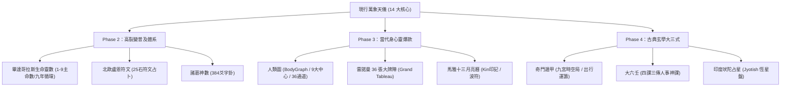

# 萬象天儀 (Astraea CelestialDao) · 未來擴充規劃藍圖 (FUTURE_PHASE.md)

本文件彙整「萬象天儀」系統尚未納入之東西方正統玄學、數理命理、古典神諭與當代身心靈占卜體系，作為後續版本演進與功能研發之路線參考池。

---

## 系統現況基線 (Current Baseline)

目前系統已集成 **14 大核心演算法與測算體系**（分屬 5 大主題維度）：
1. **東方星命**：紫微斗數 (`/ziwei`)、四柱八字 (`/bazi`)、七政四餘 (`/qizheng`)、八字合婚 (`/synastry`)
2. **歲月流年**：模擬一生 (`/simulator`)、流年生活曆 (`/annual-planner`)、每日通勝黃曆 (`/almanac`)
3. **民俗靈籤**：廟宇籤詩 (`/temple-poem`)、文鳥抽籤 (`/buncho`)、周公解夢 (`/dream`)、周易卜卦 (`/iching`)、易經姓名學 (`/naming`)
4. **西方神秘**：3D 塔羅占卜 (`/tarot`)、西洋星盤 (`/western`)
5. **檔案指南**：命盤檔案庫 (`/vault`)、使用手冊指南 (`/guide`)

---

## 一、 東方正統術數與命理擴充池 (Eastern Metaphysics Pool)

| 序號 | 體系名稱 | 所屬領域 | 核心原理與特色 | 演算法與產品落地特性 |
| :---: | :--- | :--- | :--- | :--- |
| **E-01** | **奇門遁甲** | 帝王之學 / 三式絕學 | 融合九宮八卦、八門（休生傷杜景死驚開）、九星（天蓬天任等）、八神與干支陰陽局。 | **時空運籌極致**：計算即時時家奇門盤，提供出行吉方、談判博弈策略與空間趨吉避凶指引。 |
| **E-02** | **大六壬** | 人事神課 / 三式絕學 | 與奇門、太乙並稱「三式」，號稱「人事預測第一」。以天地盤、月將加時、四課三傳推演事情因果始末。 | **精準事物診斷**：針對具體事件（求職、訴訟、尋物、疾病）輸出完整的起因、發展與終局判斷。 |
| **E-03** | **太乙神數** | 國運天時 / 三式絕學 | 專測天下大事、國運興衰、歷史週期、氣候極端與重大社會變遷。 | 宏觀大歷史與年度趨勢分析模組。 |
| **E-04** | **印度吠陀占星 (Jyotish)** | 南亞天文星象 | 採用恆星黃道（Sidereal Zodiac，帶歲差修正）、27 月宿（Nakshatras）、分盤系統（Navamsha D9）與運期系統（Vimshottari Dasha）。 | 精度極高，具獨特北印度菱形盤與南印度方格盤，全球尤其是歐美與南亞客群基礎極深厚。 |
| **E-05** | **手相與面相學 (相術)** | 觀相實體學 | 面相十二宮（命宮、財帛、官祿等）、三停五嶽、百歲流年部位；手相三大主線（生命線、智慧線、感情線）與八卦掌丘。 | 可設計互動式臉部/手掌點選圖譜，標記年齡流年對應吉凶部位。 |
| **E-06** | **諸葛神數 (384 爻)** | 靈動字卦占卜 | 依《易經》384 爻演繹而成，求測者隨機報三個漢字或三組數字，依數理換算命中對應籤詩。 | 規則確定性高、輸入門檻極低（僅需 3 個字）、籤詩富含古意與直觀警示。 |
| **E-07** | **測字學 (相字術)** | 漢字拆字易術 | 依據漢字之字形偏旁、筆畫走勢、五行歸屬、諧音借義（離合、添筆、包孕）解構當下心緒與機先。 | 結合象數理與 AI LLM 深度語言解析，具備濃厚東方文化底蘊。 |
| **E-08** | **玄空飛星風水** | 堪輿空間學 | 依據三元九運（當前為下元九運），結合宅第坐向二十四山，排布紫白九星飛泊。 | 產出「九宮空間吉凶方位圖」，標示財位、文昌位、病符煞位與佈局建議。 |
| **E-09** | **袁天罡稱骨歌** | 骨重歌訣推命 | 依生辰年月日時換算骨重（兩、錢），累加後對照專屬稱骨論命七言絕句。 | 計算迅速、娛樂性強，非常適合初階使用者快速生成籤卡分享。 |
| **E-10** | **鐵板神數 / 皇極數** | 古典秘傳數理 | 以皇極經世數理、條文編碼推演六親屬性與一生定數。 | 條文豐富、風格獨特。 |

---

## 二、 西方與全球當代神秘學擴充池 (Western & Global Esotericism Pool)

| 序號 | 體系名稱 | 所屬領域 | 核心原理與特色 | 演算法與產品落地特性 |
| :---: | :--- | :--- | :--- | :--- |
| **W-01** | **人類圖 (Human Design)** | 當代跨界體系 | 融合西洋占星、印度脈輪、猶太卡巴拉生命之樹與東方易經 64 卦。分析 9 大能量中心、36 條通道、64 個閘門與 4 大能量類型（生產者、投射者等）。 | **當代市場爆款**：人體幾何曼陀羅盤（BodyGraph）極具辨識度，能深度滿足現代人對天賦使命與內在權威之探索。 |
| **W-02** | **畢達哥拉斯生命靈數 (Numerology)** | 西方古數理學 | 依陽曆出生日推算 1~9 號主命數、卓越數（Master Numbers 11/22/33）、9 年個人流年循環與九宮空缺數連線特質。 | **傳播力極佳**：輸入極簡（僅需生日）、演算純淨確定、流年盤與連線圖表直觀，利於社群裂變傳播。 |
| **W-03** | **北歐盧恩符文 (Elder Futhark Runes)** | 北歐古代神諭 | 源自古日耳曼與北歐神話的 24 個古老象形字母＋1 個空白命運符文（Wyrd），分為三個艾特（Aett）。 | 古樸石刻木石質感、可用「三女神陣」、「奧丁單石」進行占卜，提供剛猛深邃的精神啟示。 |
| **W-04** | **雷諾曼占卜卡 (Lenormand)** | 法國經典紙牌 | 36 張具象生活圖騰卡（如騎士、幸運草、船、狐狸、十字架），無逆位，重視相鄰卡牌間的語法串連。 | 經典「36 張大牌陣 (Grand Tableau)」將全部牌鋪開，可如地圖般全景透視事業、感情與現實事件走向。 |
| **W-05** | **馬雅十三月亮曆 (Dreamspell)** | 中美洲古曆法新化 | 基於卓爾金曆（Tzolkin）260 天循環，由 20 個太陽圖騰與 13 個銀河音階組合成 260 組 Kin 印記、五大神諭與波符城堡。 | 視覺風格獨特、色彩斑斕，與自然共時性、潛意識調頻社群具備高度共鳴。 |
| **W-06** | **卡巴拉生命之樹 (Tree of Life)** | 猶太神秘學骨架 | 10 個原質球（Sephiroth）與 22 條路徑（Paths），為西方神秘學、赫密士主義與塔羅大牌之深層哲學架構。 | 適合設計為「靈魂演化階梯」、「七大脈輪轉化地圖」之深度修煉工具。 |
| **W-07** | **天使神諭卡 / 意象直覺卡 (Oracle Cards)** | 當代正向療癒 | 44~52 張不拘形式的高頻光愛主題牌卡，注重當下心靈療癒與正向頻率共振。 | 界面視覺溫潤，適合每日抽牌與冥想引導。 |

---

## 三、 既有系統之縱深擴展 (Deepening Existing Modules)

1. **西洋占星進階推運模組 (Advanced Western Astrology)**：
   - **次限盤 (Secondary Progressions)**：以「一日代表一年」推算內在心理與重要運勢轉折。
   - **太陽弧推運 (Solar Arc Directions)**：推算人生重大事件發生年代。
   - **卜卦占星 (Horary Astrology)**：以求問者提問的當下時間與地點起星盤，直接針對明確疑問（如「該換工作嗎？」）進行嚴密是非判讀。
   - **擇日占星 (Electional Astrology)**：逆向搜尋特定時間區間內最有利於開業、簽約或結婚的天星配置。

2. **民間靈籤庫容量擴增 (Expanded Temple Poem Libraries)**：
   - 擴充 **關聖帝君百籤**（求財與事業代表）。
   - 擴充 **觀世音菩薩百籤**（感情與平安代表）。
   - 擴充 **香港車公廟靈籤**（轉運化煞代表）。

---

## 四、 研發推薦路線 (Implementation Roadmap Recommendation)

綜合評估「**演算法確定性**」、「**開發複雜度**」、「**介面視覺效果 (UI/UX)**」以及「**使用者吸引力與傳播力**」，建議之演進梯隊如下：

### 優先級推薦指引：
1. **第一順位（最快見效且覆蓋面最廣）**：
   - **畢達哥拉斯生命靈數**：僅需出生年月日即可推算，流年輪盤與九宮特徵圖表視覺極佳，最適合社群分享。
   - **人類圖 (Human Design)**：當代關注度最高的體系，九大中心 BodyGraph 可帶來全新的科技玄學視覺震撼。
2. **第二順位（深化東方與西方神諭）**：
   - **奇門遁甲**：補齊東方「三式」之冠，與八字、紫微形成三大柱石。
   - **北歐盧恩符文** 或 **雷諾曼卡**：在 3D 塔羅之外，提供不同手感與思維模式的西方卡牌神諭。
